# mi-bici

<a target="_blank" href="https://cookiecutter-data-science.drivendata.org/">
    
</a>

## Propósito

El proyecto busca anticipar la operación de MiBici, el sistema de bicicleta pública de
Guadalajara, a partir de los tiempos, orígenes y destinos de sus viajes: predecir la demanda
de cada estación, identificar riesgos operativos, como quedarse sin bicicletas o sin anclajes
disponibles, y encontrar grupos de estaciones con patrones de uso similares.

## Preguntas del proyecto

| ID | Pregunta de negocio | Tipo de tarea | Quién la usaría |
| :--- | :--- | :--- | :--- |
| **P1** | ¿Cuántos viajes se iniciarán en una estación o zona en un periodo futuro? | Regresión | Operador del sistema, para planear la flota. |
| **P2** | ¿Una estación estará en riesgo de quedarse sin bicicletas o sin anclajes disponibles en un periodo futuro? | Clasificación | Equipo de rebalanceo de bicicletas. |
| **P3** | ¿Qué grupos de estaciones comparten patrones de uso y dónde se ubican en la ciudad? | Clustering | Planeación urbana y expansión del sistema. |

## Integrantes y roles

| Integrante | Matrícula | GitHub | Rol |
| :--- | :--- | :--- | :--- |
| Ariadna Meliza Martínez Anaya | A01797975 | [@MelizaMartinez98](https://github.com/MelizaMartinez98) | Ingesta reproducible, calidad y versionado de datos; P1 (regresión) |
| Claudio Salvador Rivas Anguiano | A01840294 | [@clsrivas](https://github.com/clsrivas) | Configuración centralizada y dependencias; baseline y ablaciones de P2; documentación |
| Lorena Trujillo Landeros | A01797858 | [@LorenitaTL](https://github.com/LorenitaTL) | P3 (clustering); integración de MLflow; flujo de trabajo con Git, pre-commit y CI |
| Eduardo Valencia Guzmán | A01631738 | [@Eduardo-Valencia96](https://github.com/Eduardo-Valencia96) | P2 (clasificación); ML Canvas y arquitectura |

## Setup

The project requires Python 3.12. We use [uv](https://docs.astral.sh/uv/) to create the
virtual environment (install it with `brew install uv` on macOS, or see the
[installation guide](https://docs.astral.sh/uv/getting-started/installation/)).

```bash
make create_environment
source .venv/bin/activate
make requirements
```

This installs the dependencies and the [pre-commit](https://pre-commit.com/) git hooks
(`make setup-hooks` installs only the hooks).

Activate the environment with `source .venv/bin/activate` every time you open a new
terminal to work on the project.

If you use Anaconda, run `conda deactivate` before activating `.venv`. With the `base`
environment also active, `mlflow` and `curl` can resolve to Anaconda's copies instead of the
pinned versions. Check with `which mlflow python`: both must point to `.venv/bin/`.

### Windows (without `make` or `uv`)

If you don't have `make` or `uv`, create the environment with the standard library's
`venv` and `pip`. Make sure Python 3.12 is installed (`py -3.12 --version`):

```powershell
py -3.12 -m venv .venv
.venv\Scripts\activate
python -m pip install -U pip
python -m pip install -r requirements.txt
pre-commit install
```

Activate the environment with `.venv\Scripts\activate` every time you open a new
terminal. Without `make`, run the equivalent commands directly:

| `make` target   | Equivalent command                                                                  |
| --------------- | ----------------------------------------------------------------------------------- |
| `make test`     | `python -m pytest tests`                                                            |
| `make coverage` | `python -m pytest tests --cov=mi_bici --cov-report=term-missing`                    |
| `make security` | `bandit -c pyproject.toml -r mi_bici; pip-audit -r requirements.txt; pip-audit -r requirements-validation.txt --ignore-vuln PYSEC-2026-3447 --ignore-vuln GHSA-xmj3-9gf7-h52w` |
| `make create_validation_environment` | `uv venv .venv-validation --python 3.12; uv pip install --python .venv-validation -r requirements-validation.txt` |
| `make validate-data` | `.venv-validation\Scripts\python -m mi_bici.data_validation`                   |
| `make test-validation` | `.venv-validation\Scripts\python -m pytest tests/test_data_validation.py`    |
| `make lint`     | `ruff format --check; ruff check`                                                   |
| `make format`   | `ruff check --fix; ruff format`                                                     |
| `make data`     | `python -m mi_bici.dataset main`                                                    |
| `make clean`    | `Get-ChildItem -Recurse -Directory -Filter __pycache__ \| Remove-Item -Recurse -Force` |

### Pre-commit

On every `git commit`, the hooks in `.pre-commit-config.yaml` run on the staged files:

- `ruff` lints (with `--fix`) and formats the code, using the config in `pyproject.toml`.
- Generic checks: trailing whitespace, end of file, YAML/TOML syntax, merge conflict
  markers, private keys, and files larger than 1 MB.
- `pytest` runs the test suite when the commit includes Python files. It uses the
  Python of the active environment, so activate `.venv` before committing.
- `gitleaks` blocks the commit if the staged changes contain a secret (API keys, tokens,
  passwords, connection strings). pre-commit downloads it on first use; nothing to install.
- `bandit` checks the staged files under `mi_bici/` for security issues, with the config in
  `pyproject.toml` (`make security-code` runs the same check on the whole package). To
  accept a finding, add `# nosec <rule>` with the reason on that line.

If a hook modifies files, the commit is aborted. Review the changes, `git add` them, and
commit again. To run the hooks on the whole repo:

```bash
pre-commit run --all-files
```

#### Secret scanning

The `gitleaks` hook only checks what is staged, so `pre-commit run --all-files` does not
scan the history. The `gitleaks` job in CI (`.github/workflows/pre-commit.yml`) scans the
full history on every PR and every push to `main`. To run the same scan locally, install
[gitleaks](https://github.com/gitleaks/gitleaks#installing) (`brew install gitleaks` on
macOS, `winget install gitleaks` on Windows) and run:

```bash
gitleaks git -v --redact
```

`--redact` hides the secret values, so the output is safe to paste in a PR. The full
history was scanned when the hook was added, with no findings.

If gitleaks reports something:

- **False positive** (an example hash, a test ID): add the `Fingerprint` from the output
  to `.gitleaksignore` in the repo root, one per line, and explain why in the PR.
- **Real secret:** revoke or rotate it in its service first. Once pushed to GitHub, treat it
  as compromised, even if you delete it later. Removing it from the history means rewriting
  `main`, so talk to the team before doing it.
- **Never** skip the hook with `git commit --no-verify` to get a secret through.

## Git workflow

We follow [GitHub Flow](https://docs.github.com/en/get-started/using-github/github-flow):
`main` always works, and every change goes through a branch and a Pull Request (PR).

`main` is protected: nobody can push to it directly, and every PR needs one approval
before it can be merged.

### Step by step

```bash
# 1. Start from an up-to-date main
git checkout main
git pull

# 2. Create a branch for your change
git checkout -b feat/peak-hour-features

# 3. Work and commit (as many commits as you need)
git add .
git commit -m "feat: add peak hour features"

# 4. Push the branch
git push -u origin feat/peak-hour-features

# 5. Open the PR
gh pr create --base main --fill
```

Then:

6. Ask a teammate to review the PR.
7. If the reviewer asks for changes, commit them on the same branch and `git push` again.
   The PR updates automatically.
8. Once the PR is approved and the `pre-commit`, `gitleaks` and `tests` checks are green, merge it
   with **Squash and merge** and delete the branch.
9. Go back to step 1 for your next change.

### Branch names

`type/short-description`, using the same types as the commit messages, in lowercase and
with hyphens instead of spaces:

```
feat/data-ingestion
fix/station-encoding
docs/ml-canvas
```

### Commit messages

Commit messages follow [Conventional Commits](https://www.conventionalcommits.org/):
`type: description`. A hook rejects the commit if the message doesn't match.

| Type       | Use it for                                  |
|------------|---------------------------------------------|
| `feat`     | New functionality                           |
| `fix`      | Bug fix                                     |
| `docs`     | Documentation only                          |
| `test`     | Adding or changing tests                    |
| `refactor` | Code change that doesn't change behavior    |
| `chore`    | Anything else (dependencies, config, etc.)  |

Examples:

```
feat: add peak hour features
fix: handle missing station ids
docs: explain how to download the data
```

### Pull Requests

- **Title:** same format as the commit messages (`type: description`). Because PRs are
  merged with *Squash and merge*, the PR title becomes the commit message in `main`.
- **Description:** what changed, why, and how to test it. Link the related issue if
  there is one (`Closes #<issue number>`).
- **Size:** keep PRs small, focused on a single change. They are easier to review.

### Reviews

Every team member opens at least one PR and reviews at least one PR from a teammate.
To review, go to the PR's **Files changed** tab, leave comments on specific lines if
needed, and click **Review changes**:

- **Approve:** the change is ready to merge.
- **Request changes:** something must be fixed first. Explain what and why.
- **Comment:** questions or suggestions that don't block the merge.

All review conversations must be resolved before merging.

## Ingeniería de datos — MiBici

### Objetivo y alcance

Este componente implementa un proceso reproducible para descargar, normalizar y validar los datos abiertos del sistema de bicicletas públicas MiBici de Guadalajara.

Se procesaron **6,622,260 viajes correspondientes a 18 meses**, de enero de 2025 a junio de 2026, mediante procesamiento secuencial para limitar el consumo de memoria.

**Fuentes:**
- [Portal oficial de datos abiertos MiBici](https://mibici.net/es/datos-abiertos/).
- Archivos mensuales de viajes: enero de 2025 a junio de 2026.
- Catálogo de estaciones: `nomenclatura_2026_09.csv`.

### Requisitos e instalación

El proyecto requiere Python 3.12 y las bibliotecas declaradas en requirements.txt. La descarga utiliza curl, cuyo ejecutable se identifica según el sistema operativo (curl.exe en Windows y curl en macOS/Linux). Es necesario que se encuentre instalado y disponible en el PATH.

Desde PowerShell, en la raíz del repositorio:

```powershell
py -3.12 -m venv .venv
.\.venv\Scripts\Activate.ps1
python -m pip install -r requirements.txt
```

### Ejecución

**1. Descargar y normalizar los datos**

```powershell
python -m mi_bici.dataset ingest --start-month 2025-01 --end-month 2026-06
```

Descubre los archivos mensuales publicados en el portal oficial, descarga y normaliza el catálogo de estaciones y procesa los viajes de manera secuencial.

**2. Generar el manifiesto**

```powershell
python -m mi_bici.dataset manifest
```

Genera `references/data_manifest.json`, con información de procedencia, tamaños de archivos y hashes SHA-256.

**3. Verificar la integridad**

```powershell
python -m mi_bici.dataset verify
```

Compara los hashes actuales de los archivos con los almacenados en el manifiesto.

**4. Generar el reporte de calidad**

```powershell
python -m mi_bici.data_quality
```

Genera `data/processed/data_quality_report.csv`, que combina indicadores de ingesta y correspondencia con el catálogo de estaciones para el periodo completo.

**5. Ejecutar pruebas unitarias**

```powershell
python -m pytest tests/test_dataset_pipeline.py -v
```

### Archivos generados

| Archivo o directorio | Descripción |
|---|---|
| `data/raw/` | CSV mensuales originales |
| `data/external/` | CSV original del catálogo de estaciones |
| `data/processed/viajes_AAAA_MM.parquet` | Viajes mensuales normalizados |
| `data/processed/estaciones.parquet` | Catálogo de estaciones normalizado |
| `data/processed/resumen_ingesta_2025-01_2026-06.csv` | Resumen mensual de ingesta |
| `data/processed/data_quality_report.csv` | Reporte consolidado de calidad |
| `references/data_manifest.json` | Procedencia, tamaños y hashes SHA-256 |
| `references/data_quality_report.csv` | Copia versionable de los resultados de calidad |

Los datos originales y Parquet se mantienen fuera del control de versiones de Git. Los archivos de `references/` contienen metadatos y resultados agregados.

### Normalización y controles de calidad

El pipeline conserva los identificadores de viaje y estación, las fechas de inicio y fin y la duración calculada. Los atributos personales de los usuarios no se transfieren a los archivos normalizados.

Se generan indicadores de fechas inválidas, duraciones negativas, duraciones cero e identificadores de viaje duplicados.

**Principales resultados:**

- 6,622,260 viajes procesados, sin pérdida de registros durante la normalización.
- Sin fechas inválidas, duraciones negativas ni identificadores de viaje duplicados detectados.
- 1,863 viajes con duración cero en febrero de 2026, concentrados principalmente en la segunda mitad del mes.
- Dos identificadores de estación sin correspondencia en el catálogo, 405 y 407, observados en junio de 2026.
- 976 referencias de origen y 1,078 de destino sin correspondencia en el catálogo durante junio de 2026.

Las anomalías se conservan y documentan; no se eliminan registros automáticamente.

### Limitaciones

El catálogo utilizado corresponde a septiembre de 2026, posterior al periodo de estudio. Por tanto, sus capacidades no deben interpretarse automáticamente como capacidades históricas de las estaciones. Esta limitación es especialmente relevante para la estimación del riesgo de falta de bicicletas o espacios disponibles.

Las duraciones cero requieren una decisión de tratamiento específica para cada pregunta de modelado.

Los hashes SHA-256 permiten verificar la integridad de archivos, pero no garantizan por sí mismos la exactitud del contenido ni la disponibilidad futura de las fuentes.

La comprobación de duplicados entre diferentes meses se realizó como validación transversal complementaria.

### Reproducibilidad

La ingesta procesa los archivos mensualmente para reducir la presión sobre la memoria. Durante la ejecución del periodo completo no fue necesario reducir los 18 meses originalmente acordados.

Las versiones directas de las principales dependencias se declaran en `requirements.txt`. Los hashes identifican las versiones exactas de los archivos originales y transformados utilizadas en esta ejecución. Regenerar Parquet con versiones diferentes de las bibliotecas podría modificar sus hashes.

## P1. Predicción de demanda horaria

Se implementó un modelo de regresión para predecir la cantidad de viajes
iniciados por estación y hora, utilizando variables temporales y rezagos
históricos.

El componente incluye la construcción del dataset analítico, un baseline
estacional, entrenamiento y evaluación cronológica, seguimiento de
experimentos con MLflow y pruebas automatizadas.

El modelo seleccionado, HistGradientBoostingRegressor, redujo el MAE de
prueba aproximadamente un 14 % y el RMSE un 25 % respecto al baseline.

**Documentación técnica, resultados e instrucciones de reproducción:**
[Predicción de demanda horaria (P1)](docs/p1_prediccion_demanda.md).

## P2 — Predicción de riesgo operacional

### Objetivo

La pregunta P2 busca predecir si una estación de MiBici presentará un desbalance operacional elevado durante la siguiente hora.

Para cada estación y hora `t`, el modelo utiliza información disponible hasta ese momento para predecir si el desbalance relativo durante la hora `t+1` pertenecerá al 20 % superior de la distribución observada en el conjunto de entrenamiento.

El desbalance relativo de la siguiente hora se define como:

$$
\text{ImbalanceRatio}_{t+1}
=
\frac{|D_{t+1}-A_{t+1}|}{C}
$$

donde:

- $D_{t+1}$ = número de salidas durante la siguiente hora.
- $A_{t+1}$ = número de llegadas durante la siguiente hora.
- $C$ = capacidad de la estación.

El `target_imbalance_ratio` funciona como un **proxy relativo de riesgo operacional** y no como un umbral físico o de seguridad de una estación.

### Definición de la etiqueta de riesgo

El umbral de riesgo se calcula como el percentil 80 (**P80**) de `target_imbalance_ratio`, utilizando **únicamente TRAIN**:

```text
risk_threshold = 0.066667
```

La etiqueta se construye mediante una comparación estricta:

```text
Risk = 1 si target_imbalance_ratio > risk_threshold
Risk = 0 en otro caso
```

Se utiliza `>` debido a que existen observaciones empatadas exactamente en el P80. Con `>=`, los empates habrían incrementado artificialmente la proporción de positivos de aproximadamente 19.40 % a 28.33 % en TRAIN.

El mismo `risk_threshold` calculado sobre TRAIN se aplica sin recalcularlo a validation y test.

Proporción de positivos:

| Partición | Observaciones | Positivos |
|---|---:|---:|
| Train | 5,241,600 | 19.40 % |
| Validation | 702,720 | 17.65 % |
| Test | 345,600 | 17.31 % |

### Split temporal

La partición se realiza mediante límites temporales explícitos para evitar fuga de información y mantener un protocolo reproducible:

| Partición | Periodo | Observaciones |
|---|---|---:|
| Train | 2025-01-01 → 2026-03-31 | 5,241,600 |
| Validation | 2026-04-01 → 2026-05-31 | 702,720 |
| Test | 2026-06-01 → 2026-06-30 | 345,600 |

Los límites están centralizados en `mi_bici/config.py` y la lógica de partición se encuentra en `mi_bici/modeling/splits_p2.py`.

La partición de test se reserva para la evaluación final y no se utiliza para seleccionar el modelo ni su threshold de clasificación.

### Características

El modelo utiliza 30 características, agrupadas en:

- actividad actual: `departures`, `arrivals` y `net_flow`;
- desbalance actual y capacidad;
- ubicación de la estación;
- variables temporales;
- variables cíclicas de hora y día;
- rezagos de 1, 2 y 24 horas;
- ventanas móviles históricas de 3 y 24 horas.

El pipeline de modelado utiliza:

1. imputación mediante `SimpleImputer`;
2. estandarización mediante `StandardScaler`;
3. clasificador correspondiente a la familia evaluada.

La construcción del pipeline está centralizada en `build_pipeline(model)` para mantener el mismo preprocesamiento entre las diferentes familias de modelos.

### Comparación de modelos

Se evaluaron tres familias de modelos candidatas sobre el mismo conjunto de características y utilizando la partición temporal definida para P2. Las tres se comparan contra el [baseline de persistencia](#baseline-de-persistencia), que no es un modelo entrenado:

- Logistic Regression
- HistGradientBoosting
- Random Forest

La selección se realizó sobre **validation**. Para cada familia se evaluó un threshold de clasificación y se seleccionó el punto con mejor F1 entre los thresholds que alcanzaron una precisión mínima de 0.50.

| Modelo | Threshold | Precision | Recall | F1 | ROC-AUC |
|---|---:|---:|---:|---:|---:|
| Persistencia (baseline) | — | 0.4468 | 0.4469 | 0.4468 | 0.7288 |
| Logistic Regression | 0.70 | 0.5181 | 0.4395 | 0.4756 | 0.8334 |
| HistGradientBoosting | 0.35 | 0.5158 | 0.6910 | 0.5907 | 0.8882 |
| Random Forest | 0.55 | 0.5308 | 0.6145 | 0.5696 | 0.8813 |

HistGradientBoosting presentó el mejor equilibrio entre Recall, F1 y ROC-AUC en validation, por lo que fue seleccionado como la familia candidata de P2. Las tres familias superan al baseline en F1 y ROC-AUC; la regresión logística es una candidata más, no el baseline.

### Búsqueda de hiperparámetros

Sobre HistGradientBoosting se evaluaron diferentes combinaciones de:

- `learning_rate`
- `max_iter`
- `max_leaf_nodes`
- `min_samples_leaf`

La configuración seleccionada fue:

```text
learning_rate = 0.10
max_iter = 200
max_leaf_nodes = 31
min_samples_leaf = 20
classification_threshold = 0.35
```

Con esta configuración, los resultados finales sobre validation fueron:

| Métrica | Validation |
|---|---:|
| Accuracy | 0.8313 |
| Precision | 0.5165 |
| Recall | 0.6941 |
| F1 | 0.5923 |
| ROC-AUC | 0.8893 |

### Resultados finales

El modelo final seleccionado es **HistGradientBoosting**, con el pipeline de preprocesamiento común y el threshold de clasificación `0.35`.

| Partición | Accuracy | Precision | Recall | F1 | ROC-AUC |
|---|---:|---:|---:|---:|---:|
| Train | 0.8296 | 0.5463 | 0.7170 | 0.6201 | 0.8933 |
| Validation | 0.8313 | 0.5165 | 0.6941 | 0.5923 | 0.8893 |
| Test | 0.8219 | 0.4898 | 0.6871 | 0.5719 | 0.8786 |

La diferencia entre validation y test es consistente con una evaluación sobre un periodo temporal posterior y no indica una caída abrupta del desempeño.

### Baseline de persistencia

El baseline oficial de P2 es una regla de persistencia: predice que la hora siguiente será de
riesgo si el desbalance de la hora actual ya supera el umbral.

```text
Predicción Risk = 1 si imbalance_ratio > risk_threshold
```

Usa el mismo `risk_threshold` (P80 de train), la misma comparación estricta `>` que la
etiqueta y la misma partición temporal que los modelos candidatos, así que sus métricas son
directamente comparables. No entrena nada, así que cualquier modelo útil debe superarlo. El
`imbalance_ratio` actual sirve como score para ROC-AUC.

Para reproducirlo:

```bash
python -m mi_bici.modeling.baseline_p2
```

El run `p2-baseline-persistencia-p80` se registra con `stage_of_work=baseline` y
`model_family=persistence`, junto con las mismas fechas de corte, percentil y versión de datos
que las candidatas.

Comparación del modelo final contra el baseline:

| Partición | Modelo | Precision | Recall | F1 | ROC-AUC |
|---|---|---:|---:|---:|---:|
| Validation | Persistencia (baseline) | 0.4468 | 0.4469 | 0.4468 | 0.7288 |
| Validation | HistGradientBoosting | 0.5165 | 0.6941 | 0.5923 | 0.8893 |
| Test | Persistencia (baseline) | 0.4391 | 0.4390 | 0.4391 | 0.7218 |
| Test | HistGradientBoosting | 0.4898 | 0.6871 | 0.5719 | 0.8786 |

En test, HistGradientBoosting mejora al baseline en Recall (+0.248), F1 (+0.133), ROC-AUC
(+0.157) y Precision (+0.051). La mayor ganancia está en Recall: detecta 69 % de las horas de
riesgo, contra 44 % de la regla de persistencia.

### MLflow y trazabilidad

P2 utiliza el experimento:

```text
mibici-equipo02
```

Los runs registran información de trazabilidad incluyendo:

- pregunta (`P2`);
- familia de modelo;
- etapa del experimento;
- commit de Git;
- versión de datos;
- fechas de partición;
- percentil de riesgo;
- semilla aleatoria;
- unidad de análisis;
- parámetros del modelo;
- métricas de train, validation y test.

El modelo seleccionado fue registrado en el Model Registry:

```text
mibici-equipo02-p2-riesgo
```

con el alias:

```text
champion
```

La versión registrada corresponde a la candidata final de HistGradientBoosting.
`register_p2` solo registra corridas que tengan `git_commit` y `data_version`, para que el
linaje en el Registry quede completo. La versión champion guarda como tags el run de origen,
el commit, la versión de los datos y los hiperparámetros del modelo:

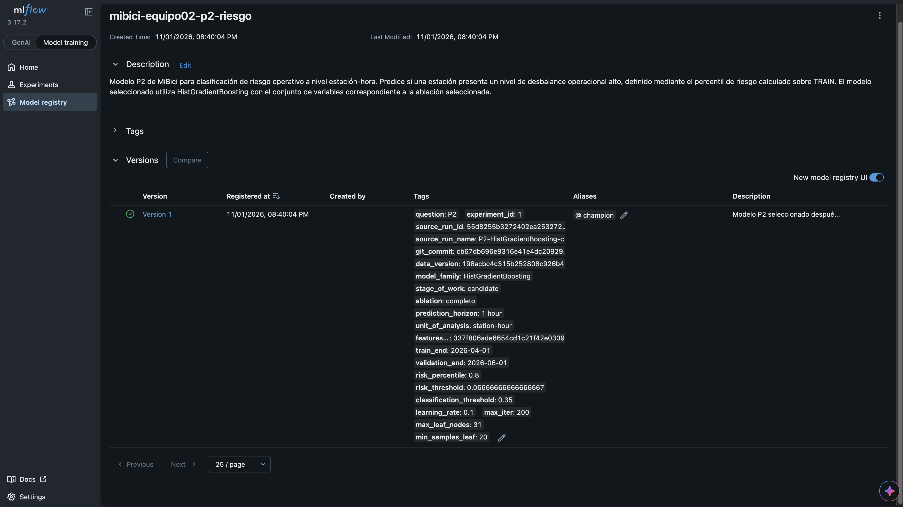

### Reproducibilidad de P2

Para ejecutar el baseline y el entrenamiento P2 desde la raíz del repositorio:

```bash
python -m mi_bici.modeling.baseline_p2
python -m mi_bici.modeling.train --question p2 --model default
```

El flujo:

1. carga `features_p2.parquet`;
2. realiza el split temporal;
3. calcula el P80 exclusivamente sobre TRAIN;
4. genera las etiquetas de riesgo;
5. construye el pipeline;
6. entrena la familia de modelo configurada;
7. evalúa train, validation y test;
8. registra parámetros, métricas y artefactos en MLflow.

La familia de modelo por defecto se controla mediante `P2_MODEL_FAMILY` en `mi_bici/config.py`.

Para ejecutar una familia específica:

```bash
python -m mi_bici.modeling.train --question p2 --model logistic_regression
python -m mi_bici.modeling.train --question p2 --model hist_gradient_boosting
python -m mi_bici.modeling.train --question p2 --model random_forest
```

La comparación de familias y la búsqueda de hiperparámetros se realizan utilizando validation; test se reserva para la evaluación final de la candidata seleccionada.

### Pruebas

El proyecto cuenta con pruebas automatizadas para validar el comportamiento del split temporal, la construcción de la etiqueta de riesgo, la evaluación del modelo, la configuración de las familias y la integración del entrenamiento P2.

El detalle de cada prueba y cómo correrlas está en [Pruebas de P2](#pruebas-de-p2) y
[Reproducibilidad del entrenamiento › P2](#p2).

## P3 — Grupos de estaciones por perfil de uso

### Formulación

Se agrupan las estaciones según cómo se usan a lo largo del día y de la semana, y se ubican
los grupos en el mapa. La unidad de análisis es la estación. No hay horizonte de
predicción: los grupos describen el periodo de entrenamiento y se valida que se mantengan en
los meses posteriores. Planeación urbana puede usarlos para decidir dónde reforzar la
redistribución y dónde conviene expandir el sistema.

La exploración y la selección del modelo están en
[`notebooks/1.0-lt-perfiles-estaciones.ipynb`](notebooks/1.0-lt-perfiles-estaciones.ipynb).

### Datos y partición

| Conjunto | Periodo | Estaciones |
| --- | --- | ---: |
| Entrenamiento | 2025-01 a 2025-12 | 368 |
| Prueba | 2026-01 a 2026-06 | 374 |

- Los perfiles y el recorte de `share_fin_semana` en su percentil 99 se calculan solo con
  entrenamiento. Los meses de prueba no participan en el ajuste.
- Se descartan los viajes de duración cero (0.06 %), que no representan uso real.
- Se excluyen las estaciones con menos de 1,000 salidas en entrenamiento (500 en los seis
  meses de prueba), que operaron solo parte del periodo y no tienen un perfil completo.

### Variables

Las funciones están en `mi_bici/features_p3.py` (`load_profile_trips`, `flow_balance`,
`build_station_profiles`):

| Variable | Descripción | Uso |
| --- | --- | --- |
| `balance_am` | (llegadas − salidas) / total, de 6 a 9 h en días laborales | Agrupa |
| `balance_pm` | Lo mismo, de 17 a 20 h | Agrupa |
| `share_fin_semana` | Proporción de salidas en sábado o domingo | Agrupa |
| `balance_dia` | Balance de todo el día laboral | Describe los grupos |
| `log_viajes_dia` | log(1 + salidas por día) | Describe los grupos |

Un balance positivo indica que la estación acumula bicicletas (destino) y uno negativo que
se vacía (origen). El volumen no se usa para agrupar porque los grupos separarían estaciones
muy usadas de poco usadas en lugar de perfiles de uso.

### Modelos y métricas

- **Baseline:** K-Means con k = 3 sobre latitud y longitud. Responde si basta la ubicación
  para separar estaciones con usos distintos.
- **Modelo candidato:** K-Means con k = 3 sobre `balance_am`, `balance_pm` y
  `share_fin_semana`, estandarizadas.

Los dos modelos se evalúan en el espacio de perfiles de uso, para que sus métricas sean
comparables:

- `train_silhouette` / `test_silhouette`: qué tan separados están los perfiles de uso.
- `train_stability_ari`: si los grupos cambian con la semilla de K-Means.
- `test_ari_vs_refit`: si los grupos se mantienen en 2026. Compara la asignación del modelo
  de 2025 con un modelo reajustado con los datos de 2026.

### Resultados

| Modelo | `train_silhouette` | `test_silhouette` | `train_stability_ari` | `test_ari_vs_refit` |
| --- | ---: | ---: | ---: | ---: |
| Baseline (ubicación) | 0.108 | 0.097 | 1.000 | 1.000\* |
| Perfil de uso | **0.357** | **0.314** | 1.000 | 0.945 |

\* Es trivial: las coordenadas de las estaciones no cambian entre periodos.

| Cluster | Estaciones | Perfil | Rasgos |
| --- | ---: | --- | --- |
| 0 | 178 | Residencial | Pierde bicicletas en la mañana y las recupera en la tarde. ~23 salidas/día. |
| 1 | 137 | Destino laboral | Gana bicicletas en la mañana y las pierde en la tarde. ~31 salidas/día. |
| 2 | 53 | Recreativo | Más uso en fin de semana (28 %) y pierde bicicletas en el día. ~15 salidas/día. |

El cluster 2 es el único que pierde bicicletas de forma sistemática, por lo que necesita
reabastecimiento aunque tenga menos volumen. Los clusters 0 y 1 se compensan a lo largo del
día, de modo que la redistribución entre ellos se concentra en las horas pico.

### Reproducibilidad de P3

Cada ejecución de `train` registra un run. El modelo `kmeans_ubicacion` es el baseline
(`stage_of_work=baseline`) y `kmeans_perfil`, el valor por defecto, es el candidato. Se
aceptan los hiperparámetros `n_clusters`, `n_init` y `features` (lista separada por comas).

```bash
# Baseline y corridas candidatas
mlflow run . -e train --experiment-name mibici-equipo02 --env-manager local \
  -P question=p3 -P model=kmeans_ubicacion
mlflow run . -e train --experiment-name mibici-equipo02 --env-manager local \
  -P question=p3 -P model=kmeans_perfil -P n_clusters=3
mlflow run . -e train --experiment-name mibici-equipo02 --env-manager local \
  -P question=p3 -P model=kmeans_perfil -P n_clusters=4
mlflow run . -e train --experiment-name mibici-equipo02 --env-manager local \
  -P question=p3 -P model=kmeans_perfil -P n_clusters=5
mlflow run . -e train --experiment-name mibici-equipo02 --env-manager local \
  -P question=p3 -P model=kmeans_perfil -P n_clusters=4 \
  -P features=balance_am,balance_pm,balance_dia,share_fin_semana
```

`python -m mi_bici.modeling.train_p3` registra el baseline y el candidato con los valores por
defecto. Cada run guarda el pipeline (`StandardScaler` + `KMeans`) como `modelo_p3`, con
firma e input example, y como artefactos el manifiesto de datos (`data/data_manifest.json`),
la configuración efectiva (`config/run_config.json`), el resumen por cluster
(`data/cluster_summary.csv`), la asignación de cada estación en entrenamiento y prueba
(`data/station_clusters.csv` y `data/station_clusters_test.csv`) y el mapa de los grupos
junto con su perfil de uso (`plots/clusters.png` y `plots/clusters_test.png`). El conjunto de
entrenamiento se registra con `mlflow.log_input`.

El modelo seleccionado (`kmeans_perfil`, k = 3) se registra como `mibici-equipo02-p3-grupos`
con su linaje y el alias `champion`:

```bash
python -m mi_bici.modeling.register_p3 --run-id <RUN_ID_DE_P3_KMEANS_PERFIL_K3>
```

La comparación de las corridas, la justificación de la selección y el registro se detallan en
[Resultados de P3 en la Entrega 2](docs/p3_entrega2_resultados.md).

### Limitaciones de P3

- Los perfiles forman un continuo, por lo que la silhouette es moderada (0.36). Los grupos son
  una segmentación útil y estable, no grupos naturales bien separados.
- Las estaciones abiertas después de 2025 (401, 402, 405 y 407) no tienen perfil de
  entrenamiento.
- El número de cada cluster depende de la semilla. Para comparar runs se deben usar los
  perfiles, no el número.

## Experimento base en MLflow

Las tres preguntas registran sus runs en un solo experimento, `mibici-equipo02`, en la base
local `mlflow.db`, que se puede cambiar con la variable de entorno `MLFLOW_TRACKING_URI` (ver
[Apuntar al servidor](#2-apuntar-al-servidor)). Los
artefactos se guardan en `mlartifacts/`. Ambos están excluidos de Git.

Requiere haber ejecutado antes la [ingesta](#ejecución). Desde la raíz del repositorio:

```bash
# P1: dataset, baseline, modelo y evaluación final
python -m mi_bici.features_p1
python -m mi_bici.modeling.baseline_p1
python -m mi_bici.modeling.train_p1
python -m mi_bici.modeling.evaluate_p1 --model-uri "runs:/<RUN_ID_P1>/modelo_p1"

# P2: features, baseline, modelo y ablaciones
python -m mi_bici.features_p2
python -m mi_bici.modeling.baseline_p2
python -m mi_bici.modeling.train_p2
python -m mi_bici.modeling.train_p2 --ablation todas

# P3: perfiles, baseline y modelo por defecto
python -m mi_bici.modeling.train_p3
```

`<RUN_ID_P1>` es el identificador del run `hist_gradient_boosting_v2`. Se usa la forma
`runs:/…/modelo_p1` porque `register_p1` verifica que la evaluación corresponda exactamente a
ese modelo (ver [Registrar el modelo elegido](#5-registrar-el-modelo-elegido-de-cada-pregunta)).

Para abrir la interfaz:

```bash
python -m mlflow ui --backend-store-uri sqlite:///mlflow.db --port 5001
```

En macOS, el puerto 5000 suele estar ocupado por AirPlay.

Cada run registra:

| Elemento | Contenido |
| --- | --- |
| Nombre | Descriptivo, por ejemplo `baseline_semanal_v1` o `p3-kmeans-perfil-uso-k3` |
| Etiquetas | `team`, `question` (`P1`, `P2` o `P3`), `git_commit` y `data_version`; desde la Entrega 2, también `model_family` y `stage_of_work` (`baseline`, `search` o `candidate`) |
| Parámetros | `data_version` (huella de `references/data_manifest.json`), rango de fechas, semilla, modelo e hiperparámetros |
| Métricas | Con el conjunto en el nombre: `mae_val`, `mae_test`, `test_recall`, `train_silhouette`, etc. |
| Artefactos | Metadatos y modelo (P1), métricas, umbral y modelo (P2), resumen, asignaciones y mapa de clusters (P3) |

La trazabilidad común está en `mi_bici/modeling/tracking.py`:

- `configure_mlflow()` activa el experimento.
- `log_traceability(question, model_family, stage_of_work)` registra las etiquetas y la
  versión de los datos.
- `log_run_config(config)` guarda la configuración efectiva de la corrida en `config/`.
- `nested_search(question, model_family)` organiza una búsqueda de hiperparámetros como una
  corrida padre con una corrida hija por combinación (ver el ejemplo en su docstring).

## Servidor de tracking y MLflow Project

Desde la Entrega 2, las corridas se lanzan con `mlflow run` contra un servidor local de
tracking. El Model Registry necesita un almacenamiento respaldado por base de datos, por eso
el servidor usa el mismo `mlflow.db`, que conserva los runs de la Entrega 1.

### 1. Levantar el servidor

En una terminal, desde la raíz del repositorio, activa el entorno y levanta el servidor. El
comando del servidor es el mismo en los dos sistemas:

```bash
# macOS / Linux
source .venv/bin/activate
mlflow server --backend-store-uri sqlite:///mlflow.db \
  --host 127.0.0.1 --port 5000
```

```powershell
# Windows (PowerShell)
.venv\Scripts\activate
mlflow server --backend-store-uri sqlite:///mlflow.db `
  --host 127.0.0.1 --port 5000
```

La interfaz queda en <http://127.0.0.1:5000>. En macOS, si el puerto 5000 está ocupado por
AirPlay, usa otro (por ejemplo, `--port 5001`) y ajústalo también en el paso 2. Deja esta
terminal abierta mientras trabajas.

### 2. Apuntar al servidor

El código sabe a qué servidor enviar los runs por la variable de entorno
`MLFLOW_TRACKING_URI`, que se lee en `mi_bici/config.py`. Hay dos formas de definirla.

#### Opción A: archivo `.env` (recomendada)

Se configura una sola vez y sirve en todas las terminales:

```bash
# macOS / Linux
cp .env.example .env
```

```powershell
# Windows (PowerShell)
Copy-Item .env.example .env
```

Al importar `mi_bici.config`, `load_dotenv()` carga las variables de `.env`. Funciona igual con
`python -m ...` que con `mlflow run`.

- `.env.example` es la plantilla y sí se sube a Git. Contiene todas las variables que usa el
  proyecto, con valores de ejemplo y sin secretos.
- `.env` es la copia de cada desarrollador. Está en `.gitignore` y nunca se sube.
- Si una variable ya está definida en la terminal (con `export` o `$env:`), ese valor gana
  sobre el de `.env`.
- Con `.env` apuntando al servidor, el servidor del paso 1 debe estar levantado. Si no lo
  está, las corridas fallan al conectarse. Para trabajar sin servidor, comenta la línea en
  `.env` y el código vuelve a escribir directo en `mlflow.db`.

Variables disponibles:

| Variable | Uso | Valor por defecto si no se define |
| --- | --- | --- |
| `MLFLOW_TRACKING_URI` | Servidor de tracking de MLflow | `sqlite:///<raíz del repositorio>/mlflow.db` |

Si agregas un `os.getenv()` al código, agrega la variable a `.env.example` y a esta tabla en
el mismo PR.

#### Opción B: variable en la terminal

Solo dura mientras la terminal esté abierta. En otra terminal, desde la raíz del repositorio:

```bash
# macOS / Linux
source .venv/bin/activate
export MLFLOW_TRACKING_URI=http://127.0.0.1:5000
```

```powershell
# Windows (PowerShell)
.venv\Scripts\activate
$env:MLFLOW_TRACKING_URI = "http://127.0.0.1:5000"
```

Hay que definirla de nuevo en cada terminal nueva. Sin ella y sin `.env`, el código escribe
directamente en `mlflow.db`, sin pasar por el servidor.

### 3. Ejecutar con `mlflow run`

El archivo `MLproject` define dos puntos de entrada:

| Punto de entrada | Qué ejecuta | Parámetros |
| --- | --- | --- |
| `ingest` | `python -m mi_bici.dataset main` | Ninguno; el periodo se toma de `mi_bici/config.py` |
| `train` | `python -m mi_bici.modeling.train` | `question` (`p1`, `p2` o `p3`), `model` y los hiperparámetros del modelo |

En la terminal del paso 2:

```bash
# macOS / Linux
# Ingesta
mlflow run . -e ingest --experiment-name mibici-equipo02 --env-manager local

# Entrenamiento: un modelo por ejecución
mlflow run . -e train --experiment-name mibici-equipo02 --env-manager local \
  -P question=p3 -P model=kmeans_perfil -P n_clusters=4
```

```powershell
# Windows (PowerShell)
# Ingesta
mlflow run . -e ingest --experiment-name mibici-equipo02 --env-manager local

# Entrenamiento: un modelo por ejecución
mlflow run . -e train --experiment-name mibici-equipo02 --env-manager local `
  -P question=p3 -P model=kmeans_perfil -P n_clusters=4
```

En PowerShell, el salto de línea se marca con un acento grave (`` ` ``) en lugar de `\`;
también puedes escribir el comando en una sola línea.

- `--experiment-name mibici-equipo02` es obligatorio: si no coincide con el experimento que
  activa el código, MLflow detiene la corrida.
- Los parámetros que no están declarados en `MLproject` (como `n_clusters`) se pasan al
  modelo de la pregunta. Los valores por defecto viven en `mi_bici/config.py`, no en
  `MLproject`.
- `--env-manager local` usa el entorno ya activado y sirve para desarrollar. Para reproducir
  desde un clon limpio, usa `--env-manager uv`: MLflow crea un entorno nuevo a partir de
  `python_env.yaml`, con las mismas versiones fijas de `requirements.txt`. En Windows, si
  no tienes `uv`, instálalo con `python -m pip install uv`.

Cada pregunta implementa en su `train_pX.py` una función `run(model, params)` que entrena un
solo modelo y abre una sola corrida de MLflow. Los modelos disponibles de cada pregunta se
documentan en su sección.

### 4. Reproducir el modelo elegido de cada pregunta

`ingest` solo genera los viajes y el catálogo de estaciones. P1 y P2 leen además su propio
dataset estación-hora, que hay que construir antes de entrenar. P3 calcula sus perfiles
directamente desde los viajes.

```bash
python -m mi_bici.features_p1   # data/processed/p1_demanda_horaria.parquet
python -m mi_bici.features_p2   # data/processed/features_p2.parquet
```

Después, en la terminal del paso 2 (los comandos funcionan igual en bash/zsh y PowerShell):

```bash
# P1: candidata B (HistGradientBoosting con max_iter=200 y learning_rate=0.05)
mlflow run . -e train --experiment-name mibici-equipo02 --env-manager local \
  -P question=p1 -P model=histgb -P max_iter=200 -P learning_rate=0.05

# P2: búsqueda con nested runs; la hija seleccionada es
# P2: HistGradientBoosting, modelo candidato/final seleccionado
mlflow run . -e train --experiment-name mibici-equipo02 --env-manager local \
  -P question=p2 -P model=hist_gradient_boosting

# P3: K-Means sobre perfiles de uso, k = 3
mlflow run . -e train --experiment-name mibici-equipo02 --env-manager local \
  -P question=p3 -P model=kmeans_perfil -P n_clusters=3
```

- Sin hiperparámetros, `-P question=p1` entrena la candidata A, no la seleccionada.
- En P2, `-P model=hist_gradient_boosting` reproduce la familia seleccionada con la
  configuración definida en `mi_bici/config.py`. El modelo registrado como `champion`
  corresponde a la candidata final de HistGradientBoosting.
- En P3, `-P model=kmeans_perfil` es obligatorio aunque sea el valor por defecto: con
  `model=default`, la corrida falla al registrar el parámetro `model`.
- La ingesta regenera `references/data_manifest.json`. No hagas commit de ese cambio; descártalo
  con `git restore references/data_manifest.json`.

### 5. Registrar el modelo elegido de cada pregunta

Cada pregunta tiene un script `register_pX.py` que registra en el Model Registry la versión
elegida, guarda su linaje (experimento, run de origen, `git_commit` y `data_version`) como
etiquetas y descripción de la versión, le asigna el alias `champion` y comprueba que el modelo
cargado por el alias da las mismas predicciones que el original. Los `<RUN_ID>` salen de la
interfaz de MLflow o de la salida de cada `mlflow run`.

```bash
# P1: primero la evaluación final sobre prueba, que register_p1 exige
python -m mi_bici.modeling.evaluate_p1 --model-uri "runs:/<RUN_ID_P1>/modelo_p1"
python -m mi_bici.modeling.register_p1 --run-id <RUN_ID_P1> \
  --evaluation-run-id <RUN_ID_DE_evaluacion_final_p1_v2>

# P2: registrar la candidata final de HistGradientBoosting
python -m mi_bici.modeling.register_p2 --run-id <RUN_ID_P2_HISTGRADIENTBOOSTING>

# P3: el run p3-kmeans-perfil-k3
python -m mi_bici.modeling.register_p3 --run-id <RUN_ID_P3>
```

| Pregunta | Modelo registrado | Se carga con |
| --- | --- | --- |
| P1 | `mibici-equipo02-p1-demanda` | `models:/mibici-equipo02-p1-demanda@champion` |
| P2 | `mibici-equipo02-p2-riesgo` | `models:/mibici-equipo02-p2-riesgo@champion` |
| P3 | `mibici-equipo02-p3-grupos` | `models:/mibici-equipo02-p3-grupos@champion` |

**Esquema de ciclo de vida: aliases, no etapas.** MLflow 3 marca como obsoletas las etapas
(`Staging`, `Production`) y recomienda aliases. `champion` señala la versión que se usa en
producción; para promover otra versión o volver atrás basta con mover el alias, sin registrar
de nuevo ni cambiar el código que carga el modelo, que siempre pide `@champion`. Se puede
añadir un alias `challenger` para una candidata en evaluación. Las tres preguntas usan el mismo
esquema, sin diferencias entre ellas. En este proyecto, "producción" significa la versión a la
que apunta `champion` y cuya carga se comprobó contra el run de origen; no implica un servicio
desplegado. Para promover o revertir una versión:

```python
from mlflow import MlflowClient

MlflowClient().set_registered_model_alias("<modelo>", "champion", "<versión>")
```


## Pruebas y chequeos

Las pruebas viven en `tests/` y se corren con `make test`. Las capturas de evidencia se guardan
en `reports/figures/evidencia/`.

Todos los comandos se corren desde la raíz del repositorio con `.venv` activo. DeepChecks
necesita versiones más antiguas de numpy, scikit-learn y pandas, así que corre en un entorno
aparte, `.venv-validation`, que se crea una vez con `make create_validation_environment`. Los
equivalentes sin `make` están en
[Windows (without `make` or `uv`)](#windows-without-make-or-uv).

| Comando | Qué hace |
| :--- | :--- |
| `make test` | Corre todas las pruebas de `tests/` con PyTest. |
| `make coverage` | Corre las pruebas y reporta el % de cobertura de `mi_bici/` por módulo. |
| `make validate-data` | Corre las suites de DeepChecks (integridad y drift) y genera los reportes en `reports/`. |
| `make test-validation` | Corre `tests/test_data_validation.py` en `.venv-validation`. |
| `make security` | Corre bandit sobre `mi_bici/` y pip-audit sobre las dependencias. |

### Reproducibilidad del entrenamiento

#### P1

Responsable: [@MelizaMartinez98](https://github.com/MelizaMartinez98).

Se verifica la configuración de `build_model()` y que dos entrenamientos
con los mismos datos sintéticos y semilla produzcan las mismas predicciones
y el mismo MAE.

Ejecución desde el ambiente principal:

    python -m pytest tests/test_reproducibility_p1.py -v

Resultado local: 2 pruebas aprobadas.

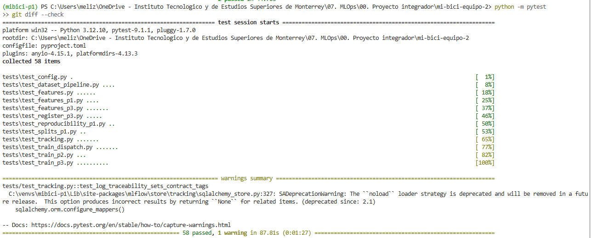

#### P2

Responsable: [@Eduardo-Valencia96](https://github.com/Eduardo-Valencia96).

`tests/test_reproducibility_p2.py` entrena dos veces cada familia candidata con
`build_pipeline(get_classifier(familia))`, los mismos datos sintéticos y la semilla
`RANDOM_STATE`, sin leer los datos de MiBici ni usar MLflow:

```bash
python -m pytest tests/test_reproducibility_p2.py -v
```

| Prueba | Qué valida |
| :--- | :--- |
| `test_p2_training_is_reproducible` (×3) | Para regresión logística, HistGradientBoosting y Random Forest, dos entrenamientos dan las mismas probabilidades y predicciones. |
| `test_random_forest_changes_with_another_seed` | Caso de control: con otra semilla, Random Forest da probabilidades distintas. Se usa Random Forest porque su bootstrap depende de la semilla; la regresión logística y HistGradientBoosting (sin early stopping con estos datos) dan lo mismo con cualquier semilla, así que no servirían de control. |

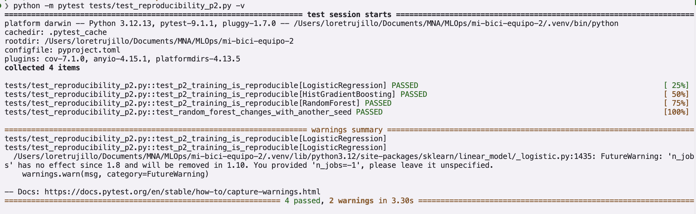

#### P3

Responsable: [@LorenitaTL](https://github.com/LorenitaTL).

`tests/test_reproducibility_p3.py` comprueba que el entrenamiento de P3 depende solo de la
semilla. Usa datos sintéticos, así que no necesita los datos de MiBici ni un servidor de
MLflow:

```bash
python -m pytest tests/test_reproducibility_p3.py -v
```

| Prueba | Qué valida |
| :--- | :--- |
| `test_fit_kmeans_is_reproducible_with_same_seed` | Dos ajustes de `fit_kmeans` con `RANDOM_STATE` dan exactamente las mismas etiquetas y centroides. |
| `test_fit_kmeans_uses_random_state_by_default` | Sin semilla explícita, `fit_kmeans` usa `RANDOM_STATE`, así que el entrenamiento es reproducible aunque no se pase la semilla. |
| `test_fit_kmeans_changes_with_another_seed_on_noisy_data` | Caso de control: con datos ruidosos, sin grupos claros, otra semilla da una agrupación distinta (ARI < 1). Si diera la misma, las pruebas anteriores no demostrarían que la semilla fija es la que hace reproducible el entrenamiento. |

Las pruebas corren en CI en macOS y Windows, y en ambos los centroides coinciden exactamente.
Los comandos para repetir las corridas de P3 en MLflow están en
[Reproducibilidad de P3](#reproducibilidad-de-p3).

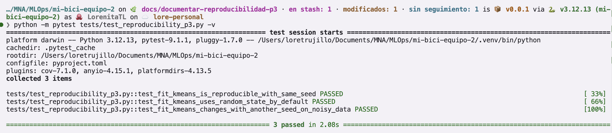

### Validación de datos con DeepChecks

Responsable: [@MelizaMartinez98](https://github.com/MelizaMartinez98).

En Windows se recomienda clonar el repositorio en una ruta corta
(por ejemplo, `C:\repos\mi-bici-equipo-2`) para reducir posibles problemas
con rutas largas al instalar o cargar dependencias compiladas.

La validación se ejecuta en `.venv-validation`, un ambiente separado dentro
del repositorio con las dependencias de `requirements-validation.txt`.
Desde la raíz del repositorio, crearlo una vez con `uv` instalado:

```bash
uv venv .venv-validation --python 3.12
uv pip install --python .venv-validation -r requirements-validation.txt
```

Ejecutar la validación en Windows (PowerShell):

```powershell
.\.venv-validation\Scripts\python.exe -m mi_bici.data_validation
```

En macOS / Linux:

```bash
.venv-validation/bin/python -m mi_bici.data_validation
```

La ejecución del reporte requiere el dataset procesado de P1.
Las pruebas sintéticas pueden ejecutarse sin los datos reales.

Las reglas propias revisan el dataset completo de P1: 4,862,675 filas.
No se encontraron campos obligatorios faltantes, claves estación-hora
duplicadas, discontinuidades horarias ni inconsistencias en los rezagos.

Los nulos iniciales de `lag_1h` (426), `lag_24h` (10,180) y `lag_168h`
(70,539) corresponden a falta de historia por estación; no se imputaron
como parte de esta validación.

DeepChecks ejecuta la suite general de integridad sobre una muestra
reproducible de 10,000 filas; algunos checks pueden submuestrearla.
Una suite separada comprueba cero nulos en campos obligatorios y cero
claves estación-hora duplicadas sobre esa muestra.

El diagnóstico de drift compara 10,000 filas de train y 10,000 de test
con semilla 42 y las particiones temporales de P1. Ningún predictor supera
los umbrales exploratorios configurados: 0.2 para variables categóricas
y 0.1 para numéricas. La distancia KS del objetivo es 0.0359 y se reporta
sin condición de aprobación.

Los nulos de rezagos se excluyen del cálculo de FeatureDrift y se
documentan aparte. Estos resultados describen distribuciones marginales
globales; no prueban estabilidad por estación ni desempeño predictivo.
Los umbrales no están calibrados con impacto de negocio.

Reportes generados en `reports/`:

- `p1_data_validation_summary.json`: estructura y rezagos del dataset completo.
- `p1_data_integrity.html`: suite general sobre la muestra.
- `p1_required_fields.html`: controles estrictos de campos obligatorios.
- `p1_drift.html`: comparación entre train y test.

Pruebas en Windows (PowerShell):

```powershell
.\.venv-validation\Scripts\python.exe -m pytest tests/test_data_validation.py -v
```

En macOS / Linux:

```bash
.venv-validation/bin/python -m pytest tests/test_data_validation.py -v
```

Con `make` en macOS / Linux, los equivalentes son `make validate-data`
y `make test-validation`.

Resultado local: 16 pruebas aprobadas. Incluyen errores deliberados de
integridad, cambios de distribución y comprobaciones de selección temporal
y reproducibilidad de las muestras. Las cinco pruebas que requieren
DeepChecks se omiten en el ambiente principal.

El script genera diagnósticos; los conteos de problemas no constituyen
un bloqueo automático del entrenamiento. En drift, un check sin ejecutar
produce un error; superar un umbral se conserva como hallazgo.

Detalle: [Diagnóstico de drift de P1](docs/p1_drift.md).

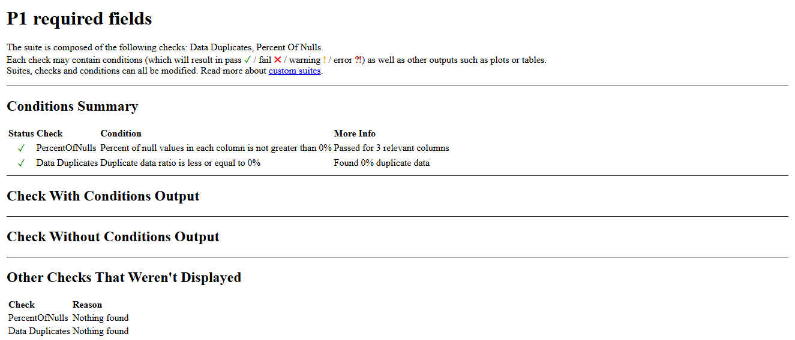

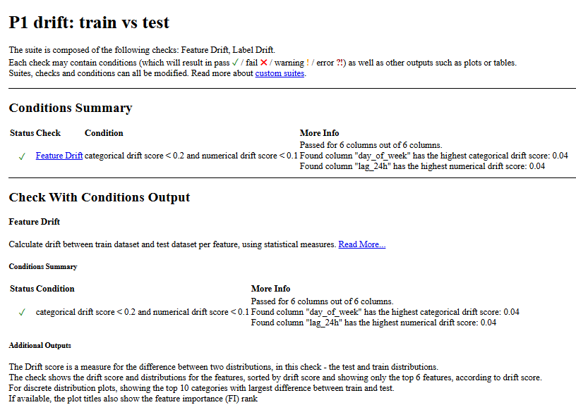

### Pruebas de P1

Responsable: [@MelizaMartinez98](https://github.com/MelizaMartinez98).

Las pruebas utilizan datos sintéticos, un modelo de juguete y archivos
Parquet temporales. No requieren los datos reales ni un servidor de MLflow.

Cubren:

- Baseline: prioridad semanal → diaria → horaria → cero, conservación de
  ceros válidos, índice y entrada vacía.
- Evaluación: MAE y RMSE con resultados conocidos, predicción perfecta,
  una observación y rechazo de métricas sin datos.
- Predicción: selección y orden de features, conversión a float32,
  conservación de nulos y recorte de predicciones negativas.
- Estaciones: identificadores faltantes, estaciones fuera del catálogo,
  conteo por viaje afectado, estaciones del catálogo sin viajes y archivo vacío.

Ejecución conjunta con reproducibilidad, desde el ambiente principal:

    python -m pytest tests/test_reproducibility_p1.py \
      tests/test_baseline_p1.py tests/test_evaluate_p1.py \
      tests/test_data_quality.py -v

En PowerShell:

    python -m pytest tests/test_reproducibility_p1.py `
      tests/test_baseline_p1.py tests/test_evaluate_p1.py `
      tests/test_data_quality.py -v

Resultado local: 16 pruebas aprobadas: 2 de reproducibilidad,
8 de baseline/evaluación y 6 de correspondencia de estaciones.

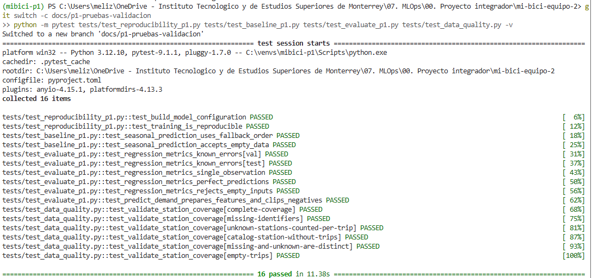

### Pruebas de P2

Responsables: [@clsrivas](https://github.com/clsrivas) y
[@Eduardo-Valencia96](https://github.com/Eduardo-Valencia96).

`tests/test_baseline_p2.py` prueba el baseline de persistencia con datos sintéticos
pequeños, sin leer archivos ni usar MLflow:

- `persistence_prediction`: un desbalance igual al umbral no se predice como riesgo, igual
  que en `create_risk_label`; la predicción es 0/1, conserva el índice y solo usa la hora
  actual.
- `persistence_metrics`: valores calculados a mano (TP=1, FP=2, FN=1, TN=3), persistencia
  perfecta, sin predicciones positivas, con todas las predicciones positivas y las cinco
  métricas que se registran en MLflow.

```bash
python -m pytest tests/test_baseline_p2.py -v
```

Si un split tiene una sola clase en la etiqueta, `roc_auc` vale `nan` (scikit-learn lo
advierte); no se fija en una prueba porque depende de la versión.

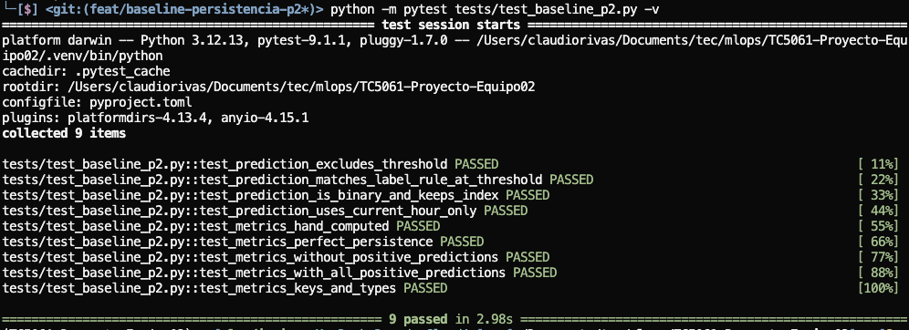

`tests/test_features_p2.py` prueba la construcción de la tabla estación-hora de
`features_p2`, también con datos sintéticos:

- `aggregate_station_flows`: las salidas se cuentan en la hora de inicio y las llegadas en
  la de fin; un viaje redondo cuenta como salida y como llegada.
- `create_station_hour_grid`: una fila por estación y hora; una estación sin viajes y una
  hora sin flujo aparecen con flujo cero; el rango llega hasta la última llegada. Los viajes
  de estaciones que no están en el catálogo se descartan.
- `add_imbalance_features` y `add_temporal_features`: signo y magnitud del desbalance,
  normalización por capacidad, calendario y codificación cíclica de la hora.
- `add_historical_features`: la primera hora de cada estación no tiene historia; los
  rezagos y las ventanas solo usan horas anteriores y no mezclan estaciones.
- `add_next_hour_target`: el objetivo es la hora siguiente de la misma estación y la última
  hora, que no tiene objetivo, se elimina.

```bash
python -m pytest tests/test_features_p2.py -v
```

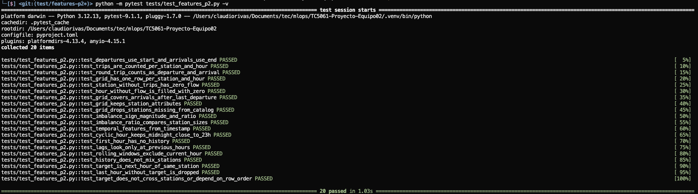

`tests/test_train_p2.py` prueba la preparación y la evaluación del entrenamiento, y
`tests/test_register_p2.py` el linaje del registro, también con datos sintéticos y sin
MLflow:

- `temporal_split`: respeta las fechas de corte de `config.py` y las tres particiones son
  disjuntas y cubren todas las observaciones.
- `create_risk_label`: la etiqueta es 0/1 y un valor igual al umbral no es riesgo (`>`
  estricto), así que los empates en el P80 no inflan la clase positiva.
- `evaluate_model`: métricas calculadas a mano (TP=FP=FN=TN=1), una probabilidad de 0.5
  cuenta como riesgo y un conjunto sin horas de riesgo da precision, recall y F1 en 0 sin
  fallar.
- Ablaciones: número de variables de cada versión y nombre del run por familia.
- `register_p2.validate_source` y `lineage_from_run`: aceptan una candidata de P2 terminada;
  rechazan corridas fallidas, de otra pregunta, de tipo baseline o sin `git_commit` o
  `data_version` (atiende el comentario del tutor sobre el linaje), y el linaje solo lleva
  los hiperparámetros del modelo registrado.

```bash
python -m pytest tests/test_train_p2.py tests/test_register_p2.py -v
```

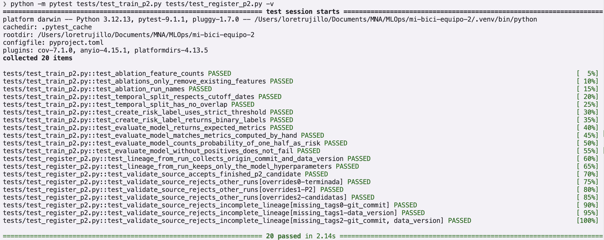

### Pruebas de P3 y de módulos comunes

Responsable: [@LorenitaTL](https://github.com/LorenitaTL).

Estas pruebas cubren P3 y el código que comparten las tres preguntas: la ingesta, las
features comunes, el contrato de MLflow y el punto de entrada de entrenamiento. Usan datos
sintéticos, archivos temporales y una base SQLite temporal de MLflow, sin los datos de
MiBici ni un servidor. Las de reproducibilidad de P3 están en
[Reproducibilidad del entrenamiento › P3](#p3).

| Archivo | Caso normal | Caso límite |
| :--- | :--- | :--- |
| `test_features_p3.py` | Con una estación residencial y una laboral, el balance de flujo y los perfiles (balances entre semana, uso en fin de semana y volumen) salen como se esperan. | Una estación solo con llegadas no se pierde; las de poca actividad se excluyen; si falta un mes, falla en lugar de armar perfiles incompletos; se descartan coordenadas inválidas. |
| `test_train_p3.py` | `resolve_config` usa el modelo de perfiles por defecto y convierte los parámetros; el nombre del run describe el modelo y las features. | Rechaza modelos o parámetros inválidos; el modelo de ubicación queda como baseline; con grupos bien separados, la estabilidad (ARI) es 1. |
| `test_register_p3.py` | Acepta una candidata de P3 terminada y su linaje tiene el run de origen, el commit y la versión de datos. | Rechaza corridas fallidas, de otra pregunta o de tipo baseline. |
| `test_features.py` | El rango de meses incluye ambos extremos; los viajes se cuentan en la hora en que ocurrieron; calendario laboral y de fin de semana. | Si falta un mes, falla; los rezagos siguen el tiempo de cada estación aunque las filas lleguen desordenadas. |
| `test_dataset_pipeline.py` | La normalización conserva todos los viajes y el hash SHA-256 coincide con un valor conocido. | Marca capacidades inválidas y duraciones negativas. |
| `test_download_security.py` | Las URLs del manifiesto pasan la validación. | Se rechazan otro esquema u otro dominio parecido al de MiBici, antes de llamar a curl y sin dejar archivos. |
| `test_tracking.py` | `log_traceability` registra el contrato de tags; la búsqueda anidada registra las corridas hijas y la mejor. | Rechaza un `stage_of_work` desconocido; falla si no hay corridas hijas; sin git instalado, el error explica qué falta. |
| `test_train_dispatch.py` | El dispatcher pasa el modelo y los parámetros extra al adaptador de cada pregunta. | Rechaza una pregunta desconocida, un parámetro sin valor, valores posicionales y un adaptador que no devuelve run. |
| `test_features_p1.py` y `test_splits_p1.py` | La malla estación-hora, los rezagos y el calendario de P1; cada fecha cae en su partición. | Las horas sin viajes quedan en cero; los rezagos no mezclan estaciones; las particiones no se traslapan. |
| `test_config.py` | Las rutas del proyecto quedan dentro de la raíz del repositorio. | — |

```bash
python -m pytest tests/test_features_p3.py tests/test_train_p3.py \
  tests/test_register_p3.py tests/test_features.py \
  tests/test_dataset_pipeline.py tests/test_download_security.py \
  tests/test_tracking.py tests/test_train_dispatch.py \
  tests/test_features_p1.py tests/test_splits_p1.py tests/test_config.py -v
```

En PowerShell, cambia `\` por `` ` `` al final de cada línea.

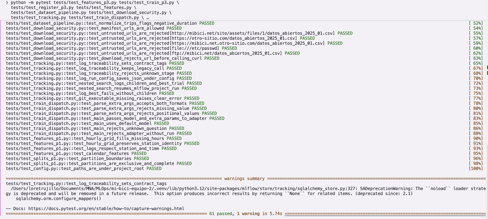

### Seguridad

Responsable: [@clsrivas](https://github.com/clsrivas).

Hay tres chequeos: bandit revisa el código, pip-audit las dependencias y gitleaks los
secretos. Los tres corren solos en los hooks o en CI, y también se pueden correr a mano:

| Chequeo | Qué revisa | Comando local | Dónde corre solo |
| :--- | :--- | :--- | :--- |
| bandit | Patrones inseguros en `mi_bici/` (subprocess, URLs, deserialización, etc.) | `make security-code` | Hook de pre-commit y job `pre-commit` de CI |
| pip-audit | Vulnerabilidades conocidas en `requirements.txt` y `requirements-validation.txt` | `make security-deps` | Job `security` de CI, en cada PR y cada lunes |
| gitleaks | Secretos en los cambios y en todo el historial | `gitleaks git -v --redact` | Hook de pre-commit y job `gitleaks` de CI |

`make -k security` corre bandit y pip-audit juntos y muestra los dos reportes aunque uno falle.

#### bandit

La configuración está en `[tool.bandit]` de `pyproject.toml`, que excluye `tests/` y
`.venv`. El análisis da 0 hallazgos: los de severidad baja se corrigieron o se aceptaron
con su justificación.

Correcciones:

- `dataset.py` solo descarga URLs `https` del dominio de MiBici (`validate_source_url`), y
  curl se llama con `--proto =https --proto-redir =https` para que una redirección no cambie
  de protocolo.
- `curl` y `git` se ejecutan con su ruta absoluta (`shutil.which`), no por nombre.

Hallazgos aceptados, cada uno con `# nosec <regla>` y su razón en el código:

| Archivo | Regla | Por qué se acepta |
| :--- | :--- | :--- |
| `mi_bici/dataset.py` | B404 | `subprocess` solo ejecuta curl, con ruta absoluta y sin shell. |
| `mi_bici/dataset.py` | B603 (×2) | Lista de argumentos sin shell; la URL es la del portal o ya pasó por `validate_source_url`. |
| `mi_bici/modeling/tracking.py` | B404 | `subprocess` solo ejecuta git, con ruta absoluta y sin shell. |
| `mi_bici/modeling/tracking.py` | B603 | `git rev-parse HEAD` con argumentos fijos, sin entrada externa. |

Para aceptar un hallazgo nuevo, agrega `# nosec <regla>` en esa línea con la razón y explícalo
en el PR. No uses `# nosec` sin regla, porque oculta cualquier hallazgo futuro en esa línea.

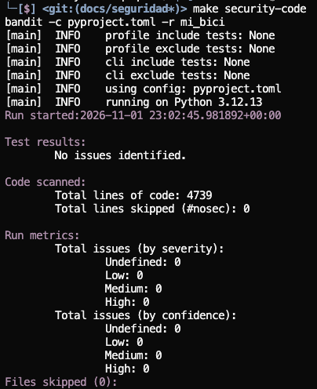

#### pip-audit

`make security-deps` audita los dos archivos por separado, porque fijan versiones distintas.
Ninguno tiene vulnerabilidades pendientes:

- `requirements.txt`: limpio. La CVE-2026-53995 de mlflow se corrigió subiendo a 3.17.2.
- `requirements-validation.txt`: limpio, con dos vulnerabilidades de `setuptools` 80.10.2
  aceptadas (PYSEC-2026-3447 y GHSA-xmj3-9gf7-h52w). pip-audit reporta "3 ignored" porque
  lista PYSEC-2026-3447 dos veces. No se puede subir setuptools porque DeepChecks 0.19.1
  necesita `pkg_resources`, que se eliminó en setuptools 81. El riesgo es bajo: ese entorno
  solo valida datos (`make validate-data`), no entrena ni sirve modelos. Los
  `--ignore-vuln` están en `VALIDATION_IGNORED_VULNS` del `Makefile` y deben quitarse cuando
  DeepChecks funcione sin `pkg_resources`.

pip-audit también avisa que no puede auditar `mi-bici`: es el paquete del propio proyecto y no
está en PyPI.

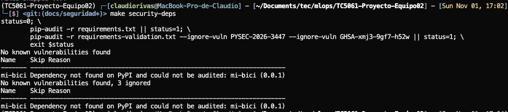

#### Secretos

`gitleaks git -v --redact` revisó los 145 commits del historial sin encontrar secretos. Qué
hacer si reporta algo está en [Secret scanning](#secret-scanning).

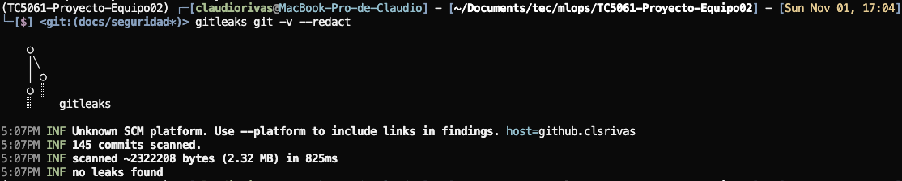

#### Prácticas

- **`.gitignore`:** excluye `.env` y `.env.*` (con excepción de `.env.example`), `*.pem` y
  `*.key`, además de los datos, los modelos serializados y la base de MLflow.
- **`.env.example`:** plantilla versionada con todas las variables que lee el código, sin
  valores reales. Cada desarrollador la copia a `.env`, que no se sube (ver
  [Opción A: archivo `.env`](#opción-a-archivo-env-recomendada)).
- **`load_dotenv`:** `mi_bici/config.py` carga `.env` al importarse y lee las variables con
  `os.getenv`, con un valor por defecto seguro. Nada sensible queda escrito en el código.
- **Hooks:** `detect-private-key` y `gitleaks` bloquean llaves y secretos antes del commit,
  y `bandit` revisa el código de `mi_bici/`. Los mismos chequeos corren en CI, así que un
  `git commit --no-verify` no evita que el PR falle.

### Cobertura

Responsable: [@LorenitaTL](https://github.com/LorenitaTL).

`make coverage` corre la suite completa y mide qué líneas de `mi_bici/` ejecutan las
pruebas:

```bash
make coverage
```

Con todos los PRs de esta actividad, la suite tiene 149 pruebas en 22 archivos: 144 pasan y
5 se omiten en el entorno principal porque requieren DeepChecks (corren en `.venv-validation`
y en el job `validation` de CI). La cobertura de `mi_bici/` pasó de **28 % a 40 %**.
También se quitaron `predict.py` y `plots.py`, que eran el código de ejemplo de la
plantilla de cookiecutter y no se usaban.

| Módulos | Cobertura | Por qué |
| :--- | ---: | :--- |
| `features_p3`, `splits_p1`, `splits_p2` | 100 % | Funciones puras, probadas con datos sintéticos. |
| `features`, `train` (dispatcher), `config`, `tracking` | 92–97 % | Lógica de features, contrato de MLflow y configuración. |
| `tracking_p1`, `tracking_p2`, `features_p2`, `features_p1`, `baseline_p2`, `data_validation`, `data_quality` | 47–71 % | Se prueban las funciones de cálculo; queda fuera la lectura de archivos y el `main`. |
| `train_p1`, `train_p2`, `train_p3`, `register_p2`, `register_p3`, `dataset`, `baseline_p1`, `evaluate_p1`, `data_tracking`, `plots_p1` | 17–48 % | Se prueban las piezas que deciden el resultado (pipeline, semilla, split, etiqueta, métricas, linaje); el resto entrena con los datos completos, descarga archivos, dibuja gráficas o llama a un servidor de MLflow. |
| `evaluate_p2`, `evaluate_peak_p1`, `register_p1` | 0 % | Scripts de reporte y registro que solo leen modelos y datos ya generados. |

La cobertura baja se concentra en código que necesita los datos de MiBici o un servidor de
MLflow, que no existen en CI. Las pruebas cubren la lógica de la que dependen los resultados:
cómo se construyen las variables y la etiqueta, cómo se parte el tiempo, que el
entrenamiento sea reproducible, cómo se evalúa y qué linaje se exige al registrar. El
siguiente paso para subirla son pruebas de `evaluate_p2` y `register_p1` con modelos
falsos, como las de `register_p2` y `register_p3`.

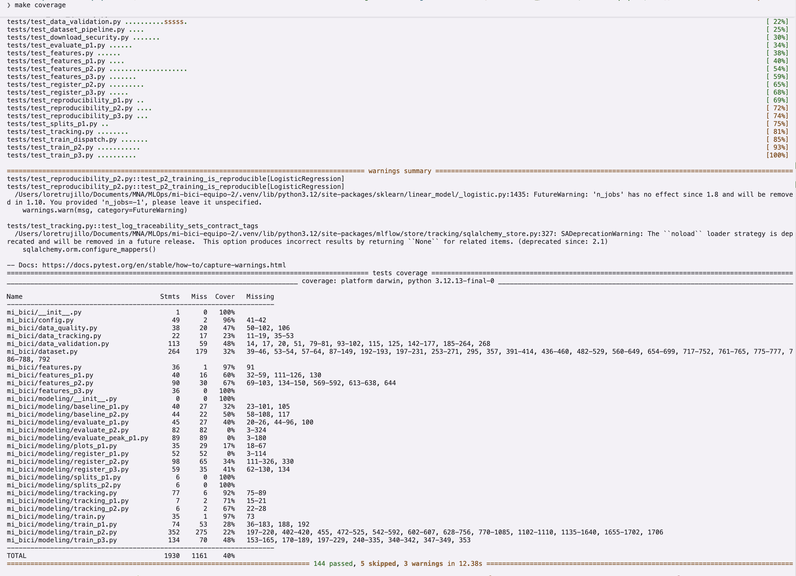

## API REST y contenedor

El modelo de riesgo de P2 (`mibici-equipo02-p2-riesgo`, alias `champion`) se sirve como una
API REST con FastAPI, dentro de un contenedor OCI construido con Podman o Docker. El código
está en `mi_bici/api/`:

| Archivo | Contenido | Responsable |
| :--- | :--- | :--- |
| `predictor.py` | Interfaz entre la API y el modelo (`Predictor`, `Prediction`) y un modelo falso para pruebas | @LorenitaTL |
| `settings.py` | Configuración por variables de entorno | @LorenitaTL |
| `main.py` | Aplicación FastAPI: `GET /health` y `POST /predict` | @LorenitaTL, @MelizaMartinez98 |
| `schemas.py` | Esquemas Pydantic de entrada y salida | @MelizaMartinez98 |
| `model_loader.py` | Carga del modelo desde el Model Registry | @Eduardo-Valencia96 |

FastAPI, Uvicorn, Pydantic y httpx (para `TestClient`) están fijados en `requirements.txt`,
así que `make requirements` deja lista la API. El contenedor instala el mismo archivo, de modo
que la imagen usa las mismas versiones con las que se entrena y se prueba.

### Contrato de la API

Responsable: [@LorenitaTL](https://github.com/LorenitaTL).

#### `GET /health`

Indica si el servicio está arriba y si el modelo está cargado. Responde **200** aunque el
modelo no se haya podido cargar, para que se pueda revisar el contenedor sin MLflow:

```json
{
  "status": "ok",
  "model_loaded": true,
  "model_name": "mibici-equipo02-p2-riesgo",
  "model_version": "3"
}
```

#### `POST /predict`

Predice si una estación tendrá desbalance alto en la siguiente hora (la etiqueta de riesgo
de P2). El cuerpo es un objeto JSON con las 30 variables de `FEATURE_COLUMNS`
(`mi_bici/modeling/train_p2.py`); todas son obligatorias y numéricas. El ejemplo es una
fila real de `features_p2.parquet` (estación 10, 13 de noviembre de 2025 a las 12:00):

```json
{
  "departures": 4.0,
  "arrivals": 3.0,
  "net_flow": 1.0,
  "absolute_imbalance": 1.0,
  "imbalance_ratio": 0.0667,
  "capacity": 15,
  "latitude": 20.6820,
  "longitude": -103.3500,
  "hour_of_day": 12,
  "day_of_week": 3,
  "is_weekend": 0,
  "hour_sin": 0.0,
  "hour_cos": -1.0,
  "dow_sin": 0.4339,
  "dow_cos": -0.9010,
  "departures_lag_1h": 3.0,
  "departures_lag_2h": 2.0,
  "departures_lag_24h": 5.0,
  "departures_rolling_3h": 2.3333,
  "departures_rolling_24h": 1.9167,
  "arrivals_lag_1h": 3.0,
  "arrivals_lag_2h": 1.0,
  "arrivals_lag_24h": 3.0,
  "arrivals_rolling_3h": 1.6667,
  "arrivals_rolling_24h": 2.1667,
  "net_flow_lag_1h": 0.0,
  "net_flow_lag_2h": 1.0,
  "net_flow_lag_24h": 2.0,
  "net_flow_rolling_3h": 0.6667,
  "net_flow_rolling_24h": -0.25
}
```

Respuesta **200** (los valores son ilustrativos):

```json
{
  "risk_probability": 0.42,
  "risk_class": 1,
  "risk_label": "alto",
  "threshold": 0.35,
  "model_name": "mibici-equipo02-p2-riesgo",
  "model_version": "3"
}
```

| Campo | Tipo | Significado |
| :--- | :--- | :--- |
| `risk_probability` | número entre 0 y 1 | Probabilidad de desbalance alto en la siguiente hora |
| `risk_class` | 0 o 1 | 1 si `risk_probability >= threshold` |
| `risk_label` | `"alto"` o `"bajo"` | `risk_class` en texto |
| `threshold` | número | Umbral de clasificación del modelo registrado (`classification_threshold`; 0.35 en el modelo final) |
| `model_name`, `model_version` | texto | Modelo y versión que respondieron, resueltos desde el alias |

Errores:

| Código | Cuándo |
| :--- | :--- |
| 422 | Falta una variable, sobra una, o un valor no es numérico o está fuera de rango |
| 503 | El modelo no está cargado (por ejemplo, MLflow no respondió al arrancar) |

#### Interfaz con el modelo

`POST /predict` no carga el modelo: recibe un objeto que cumple el protocolo `Predictor` de
`mi_bici/api/predictor.py`. Le pasa un DataFrame con `FEATURE_COLUMNS` en ese orden y recibe
una `Prediction(probability, risk_class)` por fila. El adaptador real (`model_loader.py`)
y el modelo falso `FixedPredictor` cumplen el mismo protocolo, así que el endpoint y sus
pruebas se pueden escribir antes de tener el modelo real. `check_feature_columns` rechaza
un DataFrame con columnas de más, de menos o en otro orden.

Al arrancar, `main.py` llama a `load_predictor(settings) -> Predictor` de `model_loader.py`.
Si lanza una excepción, la API arranca sin modelo: `/health` responde `model_loaded: false`
y los endpoints que usan la dependencia `get_predictor` responden 503.

#### Configuración

La API se configura con variables de entorno (`mi_bici/api/settings.py`); se leen al
arrancar, no hay rutas ni URIs fijas en el código:

| Variable | Por omisión | Uso |
| :--- | :--- | :--- |
| `MLFLOW_TRACKING_URI` | `sqlite:///<proyecto>/mlflow.db` (`mi_bici/config.py`) | Servidor o base de MLflow |
| `MODEL_NAME` | `mibici-equipo02-p2-riesgo` | Modelo registrado |
| `MODEL_ALIAS` | `champion` | Alias que se resuelve si no hay versión |
| `MODEL_VERSION` | (vacía) | Versión fija; tiene prioridad sobre el alias |

```bash
uvicorn mi_bici.api.main:app --port 8000
curl localhost:8000/health
```

### Modelo y MLflow

Responsable: [@Eduardo-Valencia96](https://github.com/Eduardo-Valencia96).

El servicio utiliza el modelo de **clasificación de riesgo operacional de P2**, desarrollado para identificar situaciones de riesgo en la operación de las estaciones de MiBici.

### Modelo utilizado

- **Modelo:** `mibici-equipo02-p2-riesgo`
- **Tipo:** Regresión Logística
- **Problema:** Clasificación binaria de riesgo operacional
- **Versión registrada:** `5`
- **Alias:** `champion`
- **Número de variables de entrada:** `30`
- **Umbral de clasificación:** `0.35`

El modelo utiliza las variables generadas por el pipeline de características de P2, incluyendo información de demanda, capacidad de las estaciones, flujo neto, variables temporales y características históricas (*lags* y *rolling windows*).

### MLflow Model Registry

El modelo se encuentra registrado en **MLflow Model Registry** y se recupera mediante el alias `champion`. Esto permite que la API no dependa de una copia local del archivo del modelo y facilita actualizar la versión utilizada por el servicio sin modificar el código de inferencia.

La URI utilizada para recuperar el modelo es:

```text
models:/mibici-equipo02-p2-riesgo@champion
```

El servicio obtiene la versión correspondiente al alias y carga el modelo mediante MLflow:

```text
MLflow Model Registry
        │
        ▼
mibici-equipo02-p2-riesgo
        │
        └── champion → versión 5
                         │
                         ▼
                    Predictor P2
                         │
                         ▼
                    FastAPI /predict
```

### Configuración

La configuración del modelo se realiza mediante las variables de configuración de la aplicación:

```text
MLFLOW_TRACKING_URI
MODEL_NAME
MODEL_ALIAS
MODEL_VERSION
```

Cuando se utiliza el alias `champion`, la aplicación resuelve automáticamente la versión registrada en MLflow.

### Validación del modelo

Se verificó que:

- El modelo puede recuperarse correctamente desde MLflow.
- El alias `champion` apunta a la versión esperada.
- El predictor conserva las **30 variables** requeridas por el modelo P2.
- El umbral de clasificación se recupera correctamente desde MLflow.
- La inferencia realizada mediante el predictor produce la misma probabilidad que la inferencia directa del modelo registrado.
- Las pruebas automatizadas del cargador del modelo fueron ejecutadas correctamente.

Como evidencia de la recuperación e inferencia se incluye:

```text
reports/figures/evidencia/e4_model_registry.png
reports/figures/evidencia/e2_e3_inferencia_fila_real.png
```

### Pruebas

La integración del cargador de MLflow cuenta con pruebas automatizadas para verificar:

1. La construcción correcta del vector de características P2.
2. La resolución del modelo mediante el alias `champion`.
3. La recuperación del umbral de clasificación.
4. La generación de probabilidades y clasificación de riesgo.

Las pruebas del proyecto se ejecutan mediante:

```bash
pytest
```

y las verificaciones de calidad mediante:

```bash
pre-commit run --all-files
```

### API REST

Responsable: [@MelizaMartinez98](https://github.com/MelizaMartinez98).

`POST /predict` estima el riesgo de desbalance de una estación para la hora siguiente.
La solicitud debe incluir las 30 variables descritas en el [contrato de la API](#post-predict).
El ejemplo siguiente usa el JSON de muestra del esquema de entrada y lo envía a la API
en ejecución.

```python
import httpx

from mi_bici.api.schemas import PredictionRequest

payload = PredictionRequest.model_json_schema()["examples"][0]
response = httpx.post("http://localhost:8000/predict", json=payload, timeout=10)
response.raise_for_status()
print(response.json())
```

Ejemplo ilustrativo de una respuesta `200 OK`:

```json
{
  "risk_probability": 0.42,
  "risk_class": 1,
  "risk_label": "alto",
  "threshold": 0.35,
  "model_name": "mibici-equipo02-p2-riesgo",
  "model_version": "3"
}
```

La API devuelve `422` si la solicitud es inválida y `503` si el predictor no está disponible.
Los valores de la respuesta dependen de los datos enviados y del modelo cargado.

### Podman/Docker

Responsable: [@clsrivas](https://github.com/clsrivas).

La imagen se define en el `Containerfile` de la raíz. `.containerignore` (y `.dockerignore`,
que apunta al mismo archivo) deja fuera del contexto todo salvo `requirements.txt`,
`pyproject.toml`, `README.md`, `LICENSE` y `mi_bici/`.

```bash
podman build -t mibici-api .
podman run --rm -p 8000:8000 mibici-api
curl localhost:8000/health
```

Con Docker los comandos son los mismos (`docker build`, `docker run`).

#### Ejecutar con el modelo del Model Registry

`mlflow.db` y `mlartifacts/` no entran en la imagen. El modelo llega al contenedor montando el
store local de MLflow como volumen:

```bash
make docker-build                          # podman build -t mibici-api .
make docker-run                            # arranca en segundo plano en el puerto 8000
curl localhost:8000/health                 # "model_loaded": true
make docker-logs                           # logs del contenedor
make docker-stop                           # lo detiene (se elimina al detenerse)
```

`make docker-run` monta:

| Host | Contenedor | Por qué |
| :--- | :--- | :--- |
| `mlflow.db` | `/app/mlflow.db` | Backend del Model Registry (`MLFLOW_TRACKING_URI=sqlite:////app/mlflow.db`) |
| `mlartifacts/` | la misma ruta absoluta del host | `mlflow.db` guarda las rutas de los artefactos como `file:///<ruta del repo>/mlartifacts/...`; montarlas en la misma ruta evita reescribirlas |

Requiere haber entrenado y registrado P2 en el `mlflow.db` local (ver
[Registrar el modelo elegido](#5-registrar-el-modelo-elegido-de-cada-pregunta)). Si
`mlflow.db` o `mlartifacts/` no existen, el target avisa y arranca la API sin modelo.

Variables:

| Variable | Valor por omisión | Uso |
| :--- | :--- | :--- |
| `CONTAINER_ENGINE` | `podman` | `make docker-run CONTAINER_ENGINE=docker` para usar Docker |
| `API_PORT` | `8000` | Puerto del host |
| `CONTAINER_MLFLOW_URI` | `sqlite:////app/mlflow.db` | `MLFLOW_TRACKING_URI` dentro del contenedor |
| `MODEL_NAME`, `MODEL_ALIAS`, `MODEL_VERSION` | los de `settings.py` | Se pasan al contenedor si están definidas en el entorno, p. ej. `MODEL_VERSION=3 make docker-run` |

Para usar un servidor de MLflow en el host en lugar del archivo, apunta a
`host.containers.internal` (Podman) o `host.docker.internal` (Docker), p. ej.
`make docker-run CONTAINER_MLFLOW_URI=http://host.containers.internal:5001`. Los artefactos
se siguen leyendo del volumen de `mlartifacts/`, porque sus rutas en el registro son locales.

#### Prueba del servicio en el contenedor

Con el contenedor corriendo (`make docker-run`) y P2 registrado como `champion`, se envía el
ejemplo de [`POST /predict`](#post-predict), guardado en
`references/api_predict_example.json`:

```bash
curl -s localhost:8000/health
curl -s -X POST localhost:8000/predict \
  -H "Content-Type: application/json" \
  -d @references/api_predict_example.json | python -m json.tool
```

Respuesta del contenedor con la versión 1 del modelo registrada localmente:

```json
{
    "risk_probability": 0.4790725575816363,
    "risk_class": 1,
    "risk_label": "alto",
    "threshold": 0.35,
    "model_name": "mibici-equipo02-p2-riesgo",
    "model_version": "1"
}
```

La probabilidad (0.479) supera el umbral de 0.35, así que la estación se clasifica con riesgo
`alto` de desbalance en la siguiente hora. La versión y la probabilidad dependen del modelo
registrado en el `mlflow.db` de quien ejecuta la prueba.

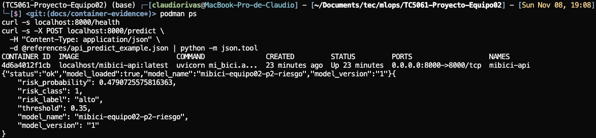

**Integración continua.** El workflow `container` (`.github/workflows/container.yml`) corre
en cada PR y en cada push a `main`: construye la imagen con Podman, arranca el contenedor
y verifica que `GET /health` responda 200. No usa MLflow, así que la API arranca sin modelo
(`model_loaded: false`). Si el `Containerfile` o el arranque de la API se rompen, el job
falla.

Evidencia: [corrida del workflow `container` sobre `main`](https://github.com/LorenitaTL/TC5061-Proyecto-Equipo02/actions/runs/42529279656),
en verde; `GET /health` respondió 200 a los ~6 s de arrancar el contenedor.

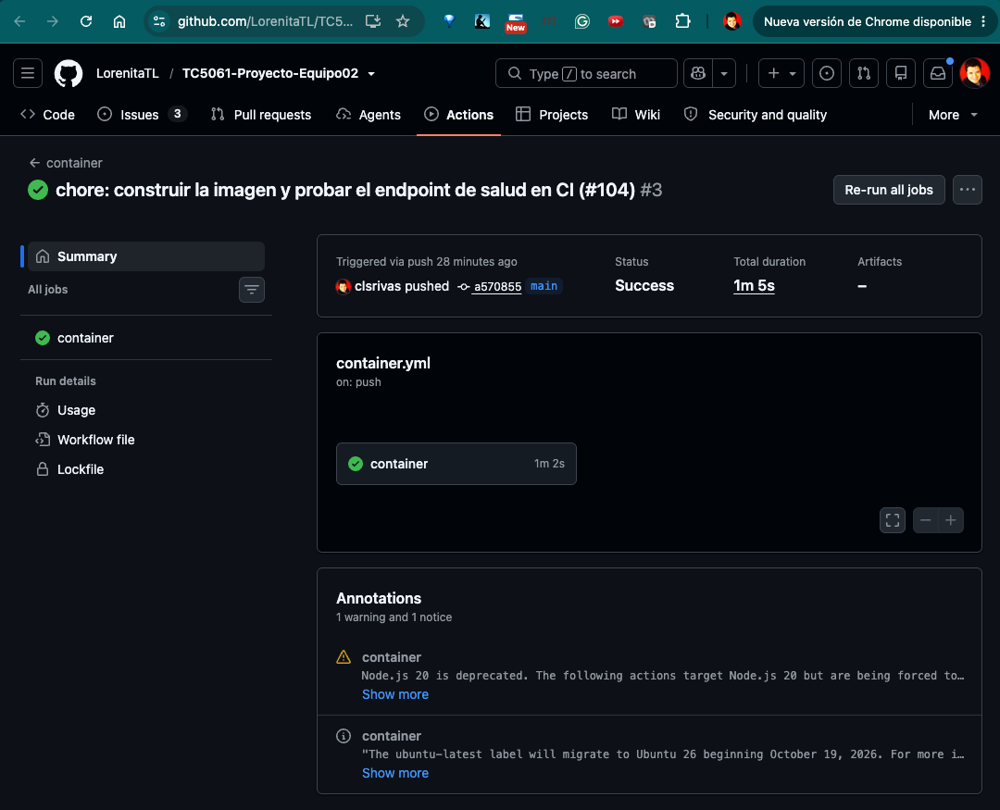

### Pruebas de la API

Responsable: [@LorenitaTL](https://github.com/LorenitaTL).

_Pendiente._

### Despliegue

Responsable: [@LorenitaTL](https://github.com/LorenitaTL).

_Pendiente._

## Buenas prácticas

- **Experimento único y runs con nombre descriptivo:** P1, P2 y P3 registran en
  `mibici-equipo02`, y cada run indica qué se probó y su versión, por ejemplo
  `baseline_semanal_v1`.
- **Parámetros de reproducción:** cada run registra fechas de partición, versión de los datos
  (`data_version`), semilla e hiperparámetros, para poder repetirlo.
- **Métricas con el conjunto en el nombre:** `mae_val`, `mae_test`, `test_recall`, etc., para
  no confundir validación con prueba.
- **Sin credenciales ni datos personales:** las credenciales van en `.env`, que no se versiona.
  La ingesta descarta `Usuario_Id`, `Genero` y `Año_de_nacimiento` de los CSV fuente, así que
  ningún dato personal llega a los modelos, al repositorio ni a MLflow.
- **Configuración en `config.py`:** rutas, fechas de corte y semillas se definen en
  `mi_bici/config.py` y se importan desde ahí, en lugar de repetirse en cada script.
- **Dependencias con versión fija:** `requirements.txt` fija la versión exacta de cada
  paquete (`paquete==x.y.z`).
- **`.gitignore`:** excluye datos (`data/`, `*.parquet`, CSV fuente), modelos serializados,
  `mlflow.db`, `mlartifacts/` y archivos de credenciales.
- **Etiquetas de trazabilidad:** cada run registra `team`, `question` (`P1`, `P2` o `P3`) y
  `git_commit` mediante `log_traceability()` de `mi_bici/modeling/tracking.py`, para ligarlo con
  la pregunta que atiende y el código que lo produjo.
- **Notebooks solo para exploración:** los notebooks siguen la convención
  `1.0-iniciales-descripcion.ipynb` (`1.0-evg-feature_engineering_p2`,
  `1.0-lt-perfiles-estaciones`), y la lógica final vive en el módulo `mi_bici/`.
- **Cambios por Pull Request revisado:** `main` está protegida; todo cambio entra por PR con al
  menos una aprobación y conversaciones resueltas (ver [Git workflow](#git-workflow)).

## Project Organization

```
├── LICENSE
├── Makefile           <- Comandos de entorno, lint, pruebas e ingesta
├── README.md
├── data               <- Excluida de Git
│   ├── external       <- Catálogo original de estaciones
│   ├── processed      <- Viajes normalizados (Parquet) y datasets de P1 y P2
│   └── raw            <- CSV mensuales originales
├── docs               <- Proyecto mkdocs y documentación de P1
├── models             <- Modelos locales de P2 (excluidos de Git)
├── notebooks          <- Exploración: 1.0-evg-feature_engineering_p2, 1.0-lt-perfiles-estaciones
├── pyproject.toml     <- Metadatos del paquete y configuración de ruff
├── references         <- ML Canvas, arquitectura, manifiesto de datos y reporte de calidad
├── reports
│   └── figures
├── requirements.txt   <- Dependencias con versión fija
├── tests              <- Pruebas de pytest
└── mi_bici            <- Código del proyecto
    ├── config.py          <- Rutas, fechas, semilla y configuración de MLflow
    ├── dataset.py         <- Ingesta, manifiesto y verificación de datos
    ├── data_quality.py    <- Reporte de calidad de datos
    ├── data_tracking.py   <- Manifiesto y datos de entrenamiento en MLflow
    ├── data_validation.py <- Validación de datos con DeepChecks
    ├── features.py        <- Funciones de features comunes a P1, P2 y P3
    ├── features_p1.py     <- Dataset estación-hora de P1
    ├── features_p2.py     <- Dataset estación-hora de P2
    ├── features_p3.py     <- Perfiles de uso por estación de P3
    └── modeling
        ├── train.py           <- Punto de entrada de entrenamiento del MLflow Project
        ├── tracking.py        <- Experimento y trazabilidad comunes de MLflow
        ├── tracking_p1.py     <- Parámetros de partición de P1
        ├── tracking_p2.py     <- Trazabilidad de P2
        ├── splits_p1.py       <- Particiones cronológicas de P1
        ├── splits_p2.py       <- Particiones cronológicas de P2
        ├── baseline_p1.py     <- Baseline estacional de P1
        ├── train_p1.py        <- Modelo de P1
        ├── plots_p1.py        <- Gráficas de validación de P1
        ├── evaluate_p1.py     <- Evaluación final de P1
        ├── evaluate_peak_p1.py <- Evaluación de horas pico de P1
        ├── register_p1.py     <- Registro del modelo de P1 con alias champion
        ├── baseline_p2.py     <- Baseline de persistencia de P2
        ├── train_p2.py        <- Familias de modelos y ablaciones de P2
        ├── evaluate_p2.py     <- Evaluación final de P2
        ├── register_p2.py     <- Registro del modelo de P2 con alias champion
        ├── train_p3.py        <- Adaptador train, baseline y candidatos de P3
        └── register_p3.py     <- Registro del modelo de P3 con alias champion
```

--------
