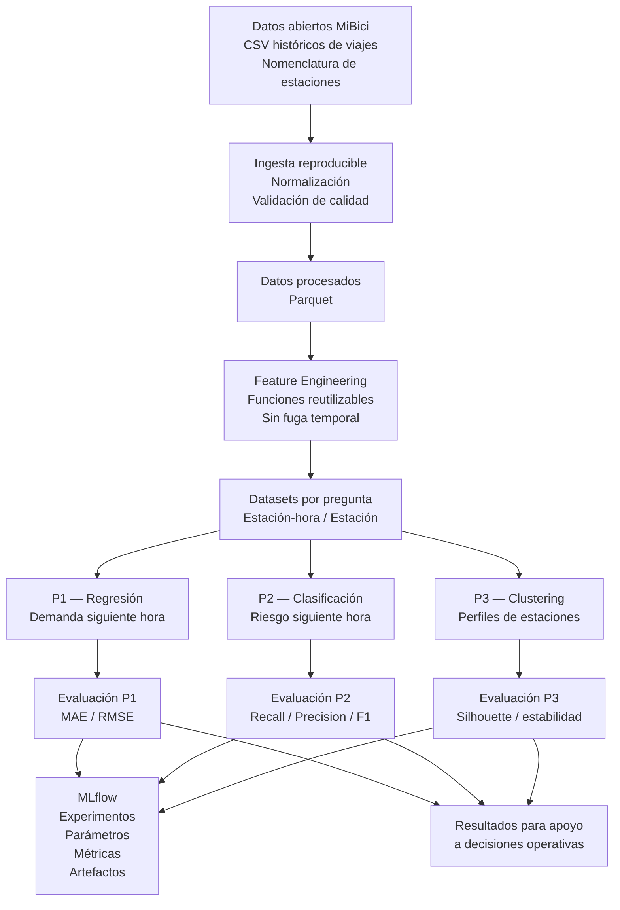

# Arquitectura de la solución ML — MiBici

## 1. Arquitectura general

La solución utiliza una arquitectura de procesamiento por lotes basada en datos históricos de MiBici. La ingesta transforma los archivos originales en datos normalizados y reproducibles; posteriormente se construyen variables agregadas a nivel estación-hora o estación, dependiendo de la pregunta de ML. Cada pregunta utiliza su propio pipeline de modelado y evaluación, mientras que MLflow centraliza el seguimiento de experimentos, métricas, parámetros y artefactos.



## 2. Flujo de datos

### Fuente

La fuente principal son los archivos históricos de viajes publicados en el portal de datos abiertos de MiBici. La nomenclatura de estaciones aporta información como identificador, ubicación y capacidad.

### Ingesta

La ingesta:

1. Lee los archivos históricos.
2. Normaliza nombres de columnas y formatos.
3. Normaliza fechas y estaciones.
4. Valida la calidad de los datos.
5. Genera datos procesados en formato Parquet.
6. Mantiene trazabilidad mediante manifiestos y reportes de calidad.

El procesamiento por lotes mensuales reduce el consumo de memoria y permite reproducir la generación de los datos procesados.

## 3. Feature Engineering

Las variables se construyen mediante funciones reutilizables: las comunes a las tres preguntas están en `mi_bici/features.py` y las propias de cada pregunta en `features_p1.py`, `features_p2.py` y `features_p3.py`.

La granularidad depende de la pregunta:

- **P1:** estación-hora.
- **P2:** estación-hora.
- **P3:** estación.

Para P1 y P2 se utilizan variables históricas y temporales evitando utilizar información futura durante la predicción.

En P2, por ejemplo, el objetivo corresponde al desequilibrio operacional de la siguiente hora, mientras que las variables históricas utilizan únicamente información disponible antes de esa hora.

## 4. Partición y validación

Para los problemas supervisados se utiliza una separación temporal:

```text
Datos históricos
      │
      ├── Train
      │
      ├── Validation
      │
      └── Test
```

La separación temporal evita utilizar información futura para entrenar el modelo y permite evaluar el comportamiento sobre periodos posteriores.

Para P2, el umbral de riesgo se calcula exclusivamente utilizando el conjunto de entrenamiento.

## 5. Pipelines por pregunta

### P1 — Predicción de demanda

Tipo de problema: regresión.

```text
Datos estación-hora
        ↓
Feature Engineering
        ↓
Variables temporales + demanda histórica
        ↓
Baseline
        ↓
Modelo de regresión
        ↓
Predicción de viajes siguiente hora
        ↓
MAE / RMSE
```

El resultado permite estimar la demanda esperada de cada estación para la siguiente hora y apoyar decisiones de redistribución.

### P2 — Riesgo operacional

Tipo de problema: clasificación binaria.

```text
Datos estación-hora
        ↓
Feature Engineering
        ↓
Lags + rolling windows + variables actuales
        ↓
Target: riesgo de la siguiente hora
        ↓
Imputación mediana
        ↓
StandardScaler
        ↓
Logistic Regression
        ↓
Probabilidad de riesgo
        ↓
Umbral 0.5
        ↓
Recall / Precision / F1 / ROC-AUC
```

El objetivo es identificar estaciones con riesgo elevado de desequilibrio operacional durante la siguiente hora.

El proxy utilizado es:

\[
R_{t+1} =
\frac{|D_{t+1}-A_{t+1}|}{C}
\]

donde:

- \(D_{t+1}\) = salidas durante la siguiente hora.
- \(A_{t+1}\) = llegadas durante la siguiente hora.
- \(C\) = capacidad de la estación.

El umbral de riesgo se define mediante el percentil 80 calculado únicamente sobre entrenamiento.

### P3 — Agrupamiento de estaciones

Tipo de problema: clustering no supervisado.

```text
Datos históricos
        ↓
Agregación por estación
        ↓
Features de uso
        ↓
Normalización
        ↓
Algoritmo de clustering
        ↓
Grupos de estaciones
        ↓
Silhouette + estabilidad
        ↓
Perfiles operativos
```

Los clusters permiten identificar estaciones con patrones de utilización similares y apoyar decisiones de expansión, reubicación o configuración.

## 6. Seguimiento de experimentos

MLflow funciona como capa transversal de experimentación:

```text
                    ┌─────────────┐
                    │     P1      │
                    └──────┬──────┘
                           │
                    ┌──────▼──────┐
                    │     P2      │
                    └──────┬──────┘
                           │
                    ┌──────▼──────┐
                    │     P3      │
                    └──────┬──────┘
                           │
                    ┌──────▼──────┐
                    │   MLflow    │
                    │ Experiments │
                    │ Parameters  │
                    │ Metrics     │
                    │ Artifacts   │
                    └─────────────┘
```

Cada problema registra sus experimentos, parámetros, métricas y artefactos para facilitar la comparación y reproducibilidad.

## 7. Herramientas y justificación

| Herramienta | Uso | Justificación |
|---|---|---|
| Python | Desarrollo de pipelines y modelos | Permite integrar ingesta, transformación, modelado y evaluación dentro de un mismo proyecto reproducible. |
| Pandas | Manipulación y agregación de datos | Adecuado para las transformaciones tabulares y agregaciones requeridas a nivel estación-hora. |
| Parquet | Datos procesados | Formato columnar eficiente para almacenar y reutilizar los datos procesados. |
| Scikit-learn | Modelado y evaluación | Proporciona pipelines reproducibles, preprocesamiento, modelos supervisados y métricas. |
| MLflow | Tracking de experimentos | Permite registrar parámetros, métricas y artefactos y comparar ejecuciones. |
| Git/GitHub | Control de versiones | Mantiene trazabilidad del código y permite colaboración mediante ramas y pull requests. |

## 8. Reproducibilidad

La solución se ejecuta desde el repositorio mediante módulos Python y configuración centralizada.

Para P2, el entrenamiento puede reproducirse mediante:

```powershell
python -m mi_bici.modeling.train_p2
```

El experimento genera métricas y artefactos que son registrados en MLflow.

## 9. Consideraciones de despliegue

La arquitectura está planteada para procesamiento batch. P1 y P2 generan resultados con una frecuencia horaria, mientras que P3 puede actualizarse con menor frecuencia debido a que los patrones de agrupamiento no requieren una predicción horaria.

El entrenamiento se realiza offline y la inferencia se plantea sobre los datos disponibles antes del periodo que se desea predecir.

La arquitectura evita depender de información futura para las variables utilizadas por los modelos supervisados.

## 10. Principios de diseño

- Separación entre datos, transformación, modelado y documentación.
- Feature engineering reutilizable.
- Separación temporal para problemas supervisados.
- Trazabilidad de experimentos mediante MLflow.
- Control de versiones mediante Git.
- Reproducibilidad mediante configuración y dependencias versionadas.
- Evaluación mediante métricas alineadas con cada pregunta de ML.
